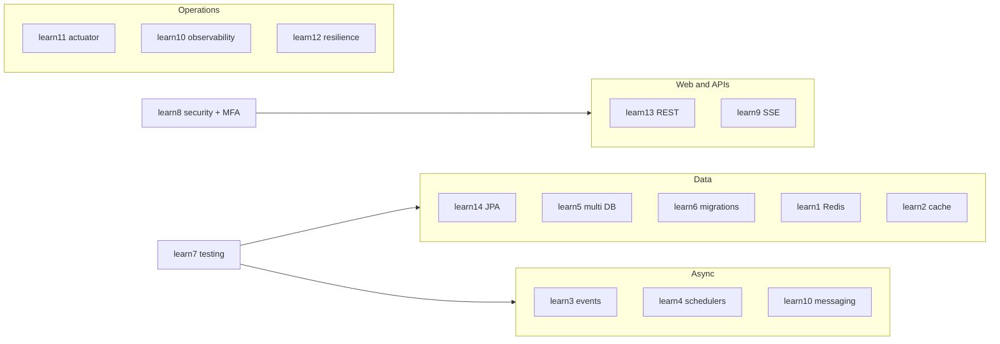

# Learn Spring Boot

Spring Boot example projects to understand advanced concepts. One Gradle
build, one folder per topic, and every topic has its own README.

- Spring Boot 4.2.0, Spring Security 7.2, Java 21, Gradle 9.9.2
- [How to run](docs/HOW-TO-RUN.md) · [Tasks](docs/TASKS.md) · [Decisions](docs/DECISIONS.md) · [Architecture](docs/architecture.md) · [Boot 4 upgrade notes](docs/UPGRADE-BOOT-4.md)

| Topic | Folder | What you learn |
| ----- | ------ | -------------- |
| Redis | [learn1-redis](learn1-redis/README.md) | every Redis data type from Spring |
| Caching | [learn2-cache-redis](learn2-cache-redis/README.md) | `@Cacheable`, `@CachePut`, `@CacheEvict` on Redis |
| Events | [learn3-events](learn3-events/README.md) | `ApplicationEventPublisher`, `@EventListener` |
| Scheduling | [learn4-schedulers](learn4-schedulers/README.md) | `@Scheduled` vs Quartz with a JDBC store |
| Multiple databases | [learn5-multiple-dbs](learn5-multiple-dbs/README.md) | two DataSources and EntityManagerFactories |
| Migrations | [learn6-db-migrations](learn6-db-migrations/README.md) | Liquibase changelogs |
| Testing | [learn7-testing](learn7-testing/README.md) | JUnit, AssertJ, Mockito, Testcontainers, WireMock, MockServer, Awaitility |
| Security | [learn8-security](learn8-security/README.md) | form, Basic, JWT, OAuth2, Authorization Server |
| MFA | [learn8-security/mfa](learn8-security/mfa/README.md) | TOTP, email links, passkeys, step-up, Keycloak |
| Server-Sent Events | [learn9-sse](learn9-sse/README.md) | `Flux`, `SseEmitter`, event-driven streams |
| Messaging | [learn10-messaging-queues](learn10-messaging-queues/README.md) | RabbitMQ exchanges, Kafka partitions, DLT, streams, transactions |
| Observability | [learn10-observability](learn10-observability/README.md) | Grafana stack, ELK, OTLP to otel-lgtm, OTel Java agent |
| Actuator | [learn11-actuator](learn11-actuator/README.md) | custom metrics, production actuator config |
| Resilience | [learn12-resilience](learn12-resilience/README.md) | retry, bulkhead, circuit breaker, rate limiter, CAP theorem |
| REST APIs | [learn13-rest-api](learn13-rest-api/README.md) | validation, RFC 9457 errors, API versioning, HTTP clients, OpenAPI |
| Data JPA | [learn14-data-jpa](learn14-data-jpa/README.md) | N+1, projections, cursor pagination, locking, transactions |

