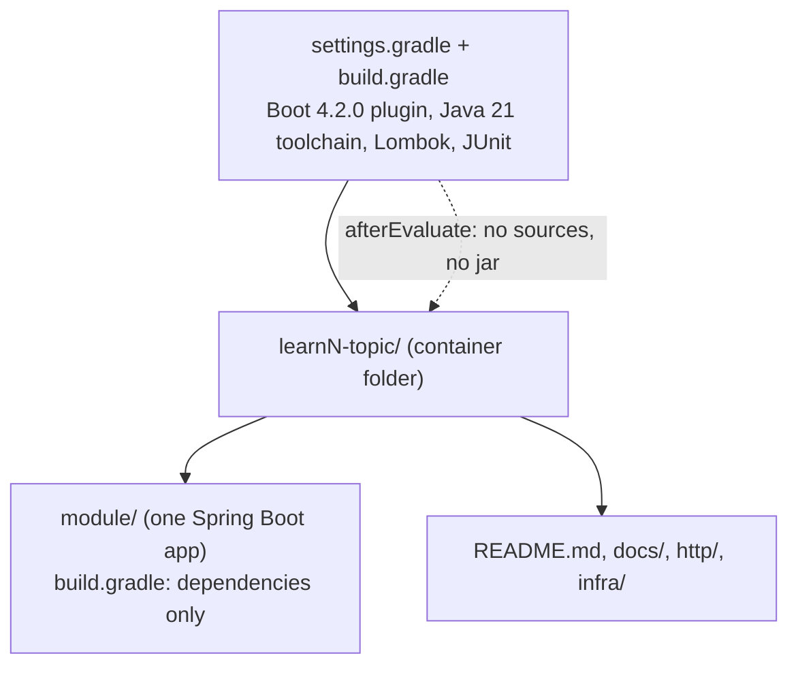

# Repository architecture

## Build layout

- Every module is listed in `settings.gradle` as `include 'topic:module'`.
- The root `subprojects {}` block applies the Boot and dependency-management
  plugins. Module build files only list dependencies, and versions come from Boot.
- Container folders have no code, so the root build turns off their jars.

## Conventions

| Item            | Convention                                                       |
| --------------- | ---------------------------------------------------------------- |
| Package         | `com.paravar.<area>`                                             |
| Ports           | older modules 8080/8081/9090; newer topics 8101–8151 (one range per topic) |
| Infra           | `infra/docker-compose.yaml` next to the topic; public image names |
| Docs per topic  | `README.md`, `docs/HOW-TO-RUN.md`, `docs/architecture.md`, `docs/DECISIONS.md`, `http/*.http` |
| Comments        | one line, says why                                               |
| Commits         | one per task, Conventional Commits, lowercase                    |

## Ports in use

| Range       | Topic                                                         |
| ----------- | ------------------------------------------------------------- |
| 8101–8102, 9102 | learn11-actuator                                          |
| 8111–8114   | learn10-observability observe3, observe4                      |
| 8121–8125   | learn8-security/mfa                                           |
| 8131–8134   | learn12-resilience                                            |
| 8141–8144   | learn13-rest-api                                              |
| 8151        | learn14-data-jpa                                              |
| 1025, 8025  | MailHog (mfa)                                                 |
| 8180, 9180  | Keycloak (mfa5)                                               |
| 3000, 4317, 4318, 9090 | otel-lgtm (observe3 / observe4; one at a time)     |
