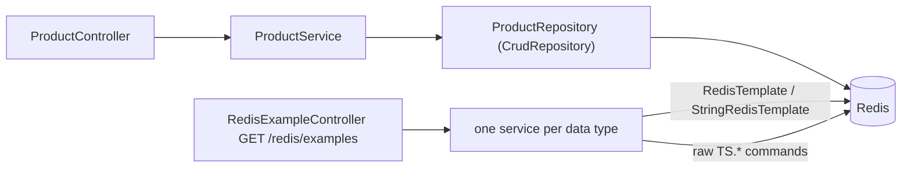

# learn1-redis

Redis from Spring Boot: a repository for simple CRUD, and one service per
Redis data type.

| Item      | Value                                                  |
| --------- | ------------------------------------------------------ |
| Port      | 8080                                                   |
| Needs     | Redis on `localhost:6379`, user `redis`, password `redis` |
| Run       | `./gradlew :learn1-redis:bootRun`                      |

| Data type     | Service                    | Typical use                              |
| ------------- | -------------------------- | ---------------------------------------- |
| String        | `RedisStringService`       | cache values, counters, TTL keys         |
| List          | `RedisListService`         | recent items, simple queues              |
| Set           | `RedisSetService`          | unique tags, membership                  |
| Hash          | `RedisHashService`         | an object with fields                    |
| Sorted set    | `RedisSortedSetService`    | leaderboards, ranges by score            |
| HyperLogLog   | `RedisHyperLogLogService`  | approximate unique counts                |
| Geo           | `RedisGeoService`          | "nearby" queries                         |
| JSON          | `RedisJsonService`         | documents (needs Redis Stack)            |
| Stream        | `RedisStreamService`       | append-only log with consumer groups     |
| TimeSeries    | `RedisTimeSeriesService`   | samples over time, downsampling rules (needs Redis Stack) |

Endpoints:

| Method | Path                  | What                          |
| ------ | --------------------- | ----------------------------- |
| POST   | `/api/products`       | save a product                |
| GET    | `/api/products/{id}`  | read one                      |
| GET    | `/api/products`       | list                          |
| GET    | `/redis/examples`     | runs every data type demo     |

Notes:

- JSON and TimeSeries need Redis Stack (for example `redis/redis-stack-server`).
  Plain Redis is enough for the other types.
- The TimeSeries code sends raw `TS.CREATE`, `TS.ADD` and `TS.RANGE` commands,
  because the Lettuce 7 client used by Boot 4 has no TimeSeries API (see
  [../docs/UPGRADE-BOOT-4.md](../docs/UPGRADE-BOOT-4.md)).
