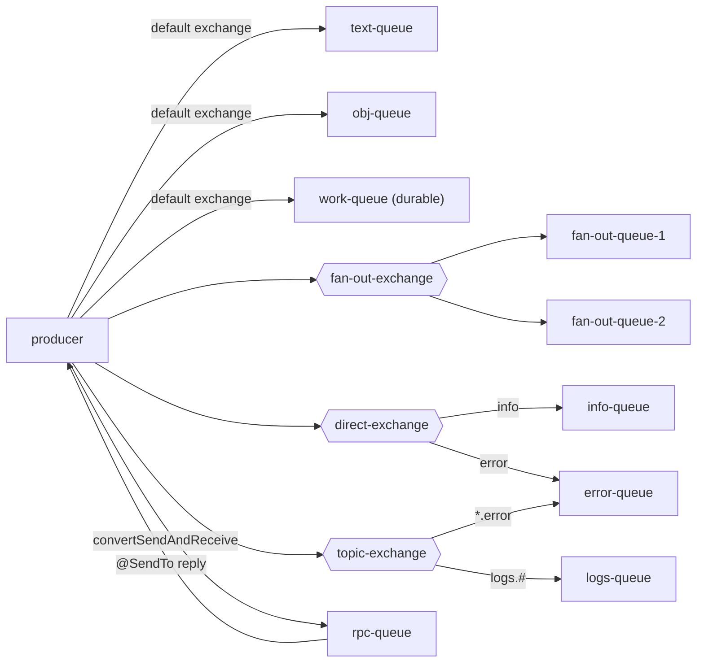
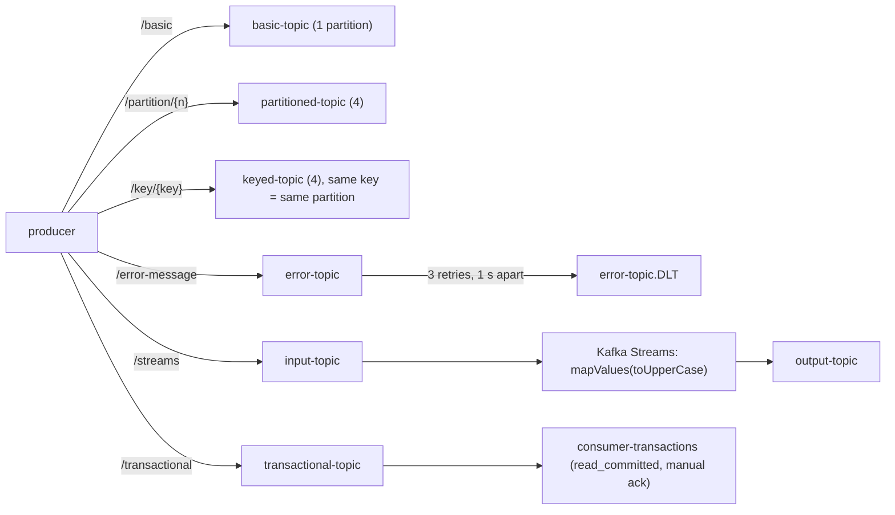

# learn10-messaging-queues

Asynchronous messaging with RabbitMQ (a broker that routes messages) and
Kafka (a distributed log).

| Module                                         | Port | Role                                   |
| ---------------------------------------------- | ---- | -------------------------------------- |
| `queue1-rabbitmq/producer`                     | 8080 | sends to every exchange type           |
| `queue1-rabbitmq/consumer`                     | 9090 | listeners per queue, auto or manual ack |
| `queue2-apache-kafka-basic/producer`           | 8080 | topics, partitions, keys, transactions |
| `queue2-apache-kafka-basic/consumer`           | 8081 | listeners, retries, dead-letter topic  |
| `queue2-apache-kafka-basic/consumer-streams`   | 8082 | Kafka Streams topology                 |
| `queue2-apache-kafka-basic/consumer-transactions` | 8083 | `read_committed`, manual ack        |

Start the broker with the `docker-compose.yaml` next to each module (RabbitMQ:
5672 and UI 15672, `rabbitmq` / `rabbitmq`; Kafka: `localhost:19092` and
kafka-ui).

## RabbitMQ

| Producer `GET`  | Pattern                                    |
| --------------- | ------------------------------------------ |
| `/basic`        | point to point, text and JSON objects      |
| `/work`         | competing consumers on one queue           |
| `/fan-out`      | publish/subscribe, every queue gets a copy |
| `/direct/{key}` | route by exact key (`info`, `error`)       |
| `/topic/{key}`  | route by pattern (`logs.#`, `*.error`)     |
| `/rpc`          | request/reply over a queue                 |

Acknowledgements: with `auto`, Spring acks after the listener returns. With
`manual`, the listener calls `channel.basicAck`/`basicNack` itself. The mode
is switched with a property (`@ConditionalOnProperty` picks the listener beans).

## Kafka

| Concept             | Where                                                          |
| ------------------- | -------------------------------------------------------------- |
| Partitions and keys | `partitioned-topic`, `keyed-topic`: order is kept per partition only |
| Consumer groups     | `group-1`, `group-2`, `group-3`: each group gets every message once |
| Retry + dead letter | `DefaultErrorHandler` + `DeadLetterPublishingRecoverer`, `FixedBackOff(1000, 3)` |
| Streams             | `@EnableKafkaStreams`, `streams-app`, uppercase transform      |
| Transactions        | producer `transaction-id-prefix: tx-`, `executeInTransaction`; consumer `isolation-level: read_committed` |
| Delivery            | `acks=all`, `retries=3`                                        |

## RabbitMQ or Kafka?

| Question                          | RabbitMQ                     | Kafka                              |
| --------------------------------- | ---------------------------- | ---------------------------------- |
| Model                             | queues, deleted when consumed | log, kept for the retention period |
| Routing                           | rich (direct, topic, headers) | by topic and partition             |
| Replay old messages               | no                           | yes, reset the offset              |
| Ordering                          | per queue                    | per partition                      |
| Typical use                       | task queues, RPC, routing    | event streaming, analytics, event sourcing |
