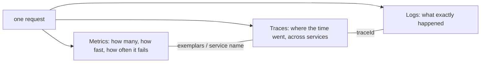
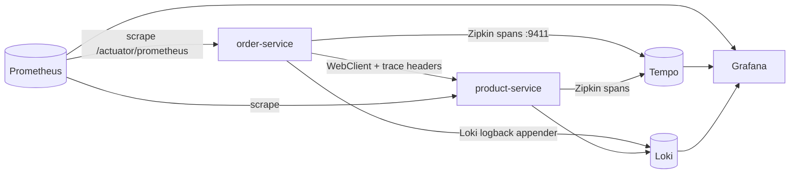
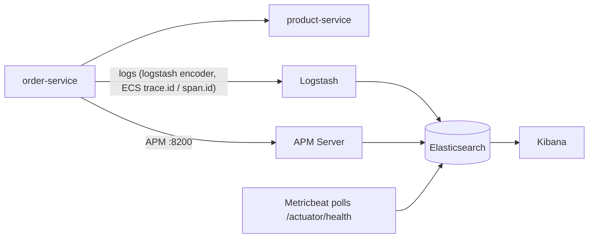

# learn10-observability

The same idea four ways: an `order-service` calls a `product-service`, and we
want metrics, traces and logs that line up.

| Module                   | Signals go to                          | Instrumentation                         | Docs |
| ------------------------ | -------------------------------------- | --------------------------------------- | ---- |
| `observe1-grafana-stack` | Prometheus, Tempo, Loki, Grafana (4 containers) | Micrometer, Brave → Zipkin, Loki appender | this page |
| `observe2-elk-stack`     | Elasticsearch, Logstash, APM Server, Kibana, Metricbeat | Elastic APM settings, ECS log fields | this page |
| `observe3-otel-lgtm`     | `grafana/otel-lgtm` (1 container)      | Micrometer + OTLP for all three signals | [README](observe3-otel-lgtm/README.md) |
| `observe4-otel-javaagent` | `grafana/otel-lgtm`                   | OpenTelemetry Java agent, no code       | [README](observe4-otel-javaagent/README.md) |

Concept notes: [info.md](info.md).

## The three pillars

## observe1-grafana-stack

| Item     | Value                                                         |
| -------- | ------------------------------------------------------------- |
| Services | `order-service` 8080 (`GET /whs/jai-ganesha` calls product), `product-service` 8081 (`GET /products`) |
| Infra    | `observe1-grafana-stack/infra/docker-compose.yaml`: Grafana 3000, Prometheus 9090, Loki 3100, Tempo 3200 + Zipkin 9411 |
| Run      | infra `docker compose up -d`, then both services with `bootRun` |

Key points: metrics are pulled (scraped) by Prometheus. Traces use the Brave
bridge (`spring-boot-starter-zipkin`). The `WebClient` must come from
`WebClient.Builder`, or trace headers aren't propagated. Logs carry `traceId`
and `spanId`.

## observe2-elk-stack

| Item     | Value                                                         |
| -------- | ------------------------------------------------------------- |
| Services | the same two services and endpoints                           |
| Infra    | `observe2-elk-stack/infra/docker-compose.yaml`: Elasticsearch 9200, Logstash 5044, APM Server 8200, Kibana 5601, Metricbeat |

## Which one?

| Need                                    | Pick                     |
| --------------------------------------- | ------------------------ |
| quickest local setup, all signals linked | observe3 (otel-lgtm)    |
| zero code changes, many libraries       | observe4 (Java agent)    |
| learn each Grafana component separately | observe1                 |
| your company runs Elastic               | observe2                 |
