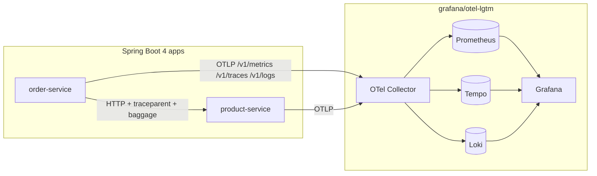

# observe3-otel-lgtm

Metrics, traces and logs from Spring Boot 4 over OTLP into one
`grafana/otel-lgtm` container (OTel Collector, Prometheus, Tempo, Loki, Grafana).

Compare with `observe1-grafana-stack`, which needs four containers, a
Prometheus scrape config, a Loki appender and a Zipkin endpoint. Here every
signal uses one protocol (OTLP) to one endpoint (`:4318`).

| Module            | Port | Role                                                   |
| ----------------- | ---- | ------------------------------------------------------ |
| `order-service`   | 8111 | `POST /orders`, calls product-service with `RestClient` |
| `product-service` | 8112 | `GET /products/{id}`; `slow` waits 800 ms, `broken` returns 500 |
| `infra` (lgtm)    | 3000, 4317, 4318, 9090 | Grafana, OTLP gRPC / HTTP, Prometheus API |

- How to run: [docs/HOW-TO-RUN.md](docs/HOW-TO-RUN.md)
- Architecture: [docs/architecture.md](docs/architecture.md)
- Decisions: [docs/DECISIONS.md](docs/DECISIONS.md)
- Requests: [http/observe3.http](http/observe3.http)

## What each piece teaches

| Concept                | Where                                                     |
| ---------------------- | --------------------------------------------------------- |
| One starter for OTLP   | `spring-boot-starter-opentelemetry` (metrics, traces, logs SDK) |
| Metrics push, not scrape | `management.otlp.metrics.export.url`, `step: 10s`       |
| Traces                 | `management.opentelemetry.tracing.export.otlp.endpoint`   |
| Logs with trace ids    | `logback-spring.xml` `OpenTelemetryAppender` + `install(openTelemetry)` |
| Context propagation    | `RestClient.Builder` from Boot adds `traceparent`         |
| Baggage                | `customer-id` header: remote field, span tag, MDC and log attribute |
| Manual span + timer    | `Observation.createNotStarted("order.pricing", ...)`      |
| Business counters      | `orders.created{product}`, `orders.failed{reason}`        |
| Resource attributes    | `deployment.environment=local` on every signal            |
| Dashboard as code      | `infra/grafana/spring-services.json`, provisioned at start |

## Metric names after OTLP

Micrometer's OTLP registry records time in milliseconds by default, so the
Prometheus names end in `_milliseconds`. The service name becomes the `job` label.

| Micrometer             | Prometheus (via OTLP)                         |
| ---------------------- | --------------------------------------------- |
| `http.server.requests` | `http_server_requests_milliseconds_bucket`, `_count`, `_sum` |
| `orders.created`       | `orders_created_total`                        |
| `order.pricing`        | `order_pricing_milliseconds_count`            |
| `jvm.memory.used`      | `jvm_memory_used_bytes`                       |
