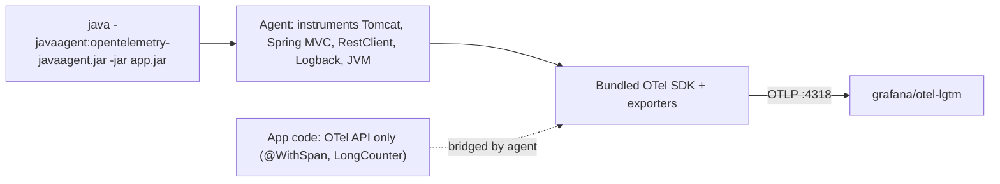

# observe4-otel-javaagent

The same two services as `observe3-otel-lgtm`, but with no telemetry starter
and no telemetry config in Spring. The OpenTelemetry Java agent adds traces,
metrics and logs at runtime by rewriting bytecode.

| Module            | Port | Role                                                       |
| ----------------- | ---- | ---------------------------------------------------------- |
| `order-service`   | 8113 | `POST /orders`; OTel API counter and `@WithSpan`           |
| `product-service` | 8114 | plain Spring MVC, zero OTel code                           |
| `infra` (lgtm)    | 3000, 4317, 4318, 9090 | same backend as observe3                 |

- How to run: [docs/HOW-TO-RUN.md](docs/HOW-TO-RUN.md)
- Architecture: [docs/architecture.md](docs/architecture.md)
- Decisions: [docs/DECISIONS.md](docs/DECISIONS.md)
- Requests: [http/observe4.http](http/observe4.http)

## Micrometer starter vs Java agent

| Topic               | observe3 (Micrometer + starter)              | observe4 (Java agent)                               |
| ------------------- | -------------------------------------------- | --------------------------------------------------- |
| Setup               | dependency + `application.yaml`              | `-javaagent` + `-Dotel.*` flags, no code            |
| Config source       | Spring properties                            | `otel.*` system properties or `OTEL_*` env vars     |
| Metric names        | Micrometer: `http_server_requests_milliseconds` | OTel semantic conventions: `http_server_request_duration_seconds` |
| Labels              | `uri`, `status`, `method`                    | `http_route`, `http_response_status_code`, `http_request_method` |
| Custom spans        | `Observation` / `@Observed`                  | `@WithSpan`, `@SpanAttribute`, `Span.current()`     |
| Custom metrics      | `MeterRegistry`                              | `GlobalOpenTelemetry.getMeter(...)`                 |
| Logs                | add appender + `install(openTelemetry)`      | captured automatically                              |
| Coverage            | what Spring instruments                      | 100+ libraries (JDBC, Kafka, Redis, ...) out of the box |
| Startup cost        | small                                        | a few seconds slower (bytecode transformation)      |
| Native image        | works                                        | not supported                                       |
| Version coupling    | follows Boot                                 | independent of Boot; upgrade the agent separately   |

The agent's service names end in `-agent`, so both projects can send to
the same backend without mixing series.
