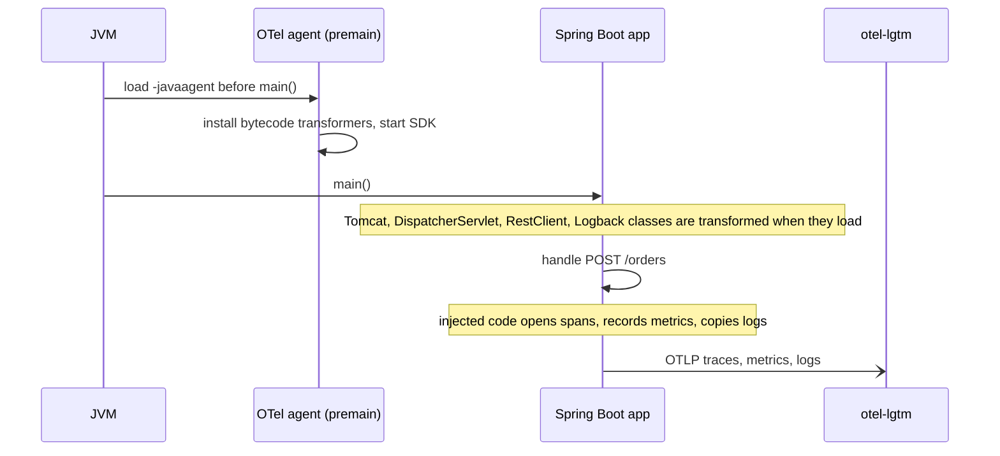
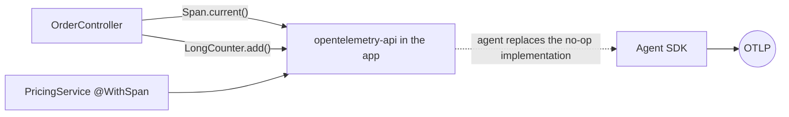

# observe4-otel-javaagent architecture

## How the agent hooks in

## Code using the OTel API

Without the agent, the same jar still runs. `GlobalOpenTelemetry` falls back
to a no-op implementation, so the calls cost nothing and export nothing.
