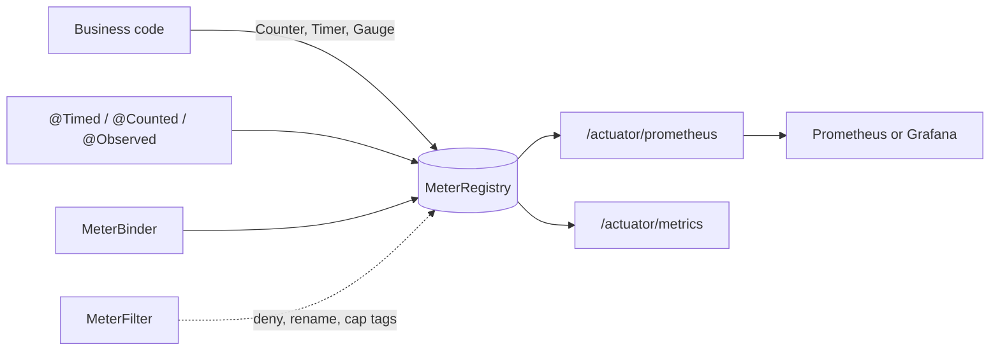

# learn11-actuator

Spring Boot Actuator in depth: custom business metrics, then the production
configuration around them.

| Module                     | Port         | Learn                                                                       |
| -------------------------- | ------------ | --------------------------------------------------------------------------- |
| `actuator1-custom-metrics` | 8101         | every Micrometer meter type, annotations, `MeterFilter`, cardinality limits |
| `actuator2-advanced-config` | 8102 / 9102 | exposure, security, health groups, probes, custom endpoints, runtime log levels |

- How to run: [docs/HOW-TO-RUN.md](docs/HOW-TO-RUN.md)
- Architecture: [docs/architecture.md](docs/architecture.md)
- Decisions: [docs/DECISIONS.md](docs/DECISIONS.md)
- Requests: [http/](http/)

## actuator1-custom-metrics

A small shop. Every meter type is attached to a real action.

| Meter                    | Type                         | Where                   | Why this type                                  |
| ------------------------ | ---------------------------- | ----------------------- | ---------------------------------------------- |
| `shop.orders.placed`     | `Counter` with `payment` tag | `OrderService.place`    | counts that only go up                         |
| `shop.orders.failed`     | `@Counted(recordFailuresOnly)` | `OrderService.place`  | failures, tagged with the exception            |
| `shop.order.amount`      | `DistributionSummary` + SLO  | `OrderService.place`    | sizes, not times; buckets for 500 / 1000 / 5000 |
| `shop.order.processing`  | `Timer` + client percentiles | `OrderService.place`    | latency with p50 / p95 / p99                   |
| `shop.order.lookup`      | `@Timed`                     | `OrderService.find`     | latency without touching the code              |
| `shop.inventory.stock`   | `Gauge` per product          | `InventoryMetrics`      | a current value that goes up and down          |
| `shop.inventory.restocks` | `FunctionCounter`           | `InventoryMetrics`      | reads a counter the domain already keeps       |
| `shop.report.generation` | `LongTaskTimer`              | `ReportService`         | work still running (active count, duration)    |
| `shop.recommendations`   | `@Observed`                  | `RecommendationService` | one Observation, a timer now, a span later     |
| `shop.visits`            | `Counter` with `user` tag    | `CardinalityController` | anti-pattern, capped by a `MeterFilter`        |

Things to notice:

- `management.metrics.tags.*` adds `application` and `region` to every meter.
- `MeterFilter.renameTag` turns `payment` into `payment.method` without
  changing the code that records it.
- `MeterFilter.maximumAllowableTags` stops `shop.visits` at 20 series. A user id
  as a tag is the classic way to overload Prometheus.
- Client-side percentiles (`publishPercentiles`) can't be combined across
  instances. Histograms (`serviceLevelObjectives`, `percentiles-histogram`) can,
  using `histogram_quantile` in PromQL.
- In Prometheus output, a `LongTaskTimer` shows `_count` as the number of active
  tasks and `_sum` as their running time.
