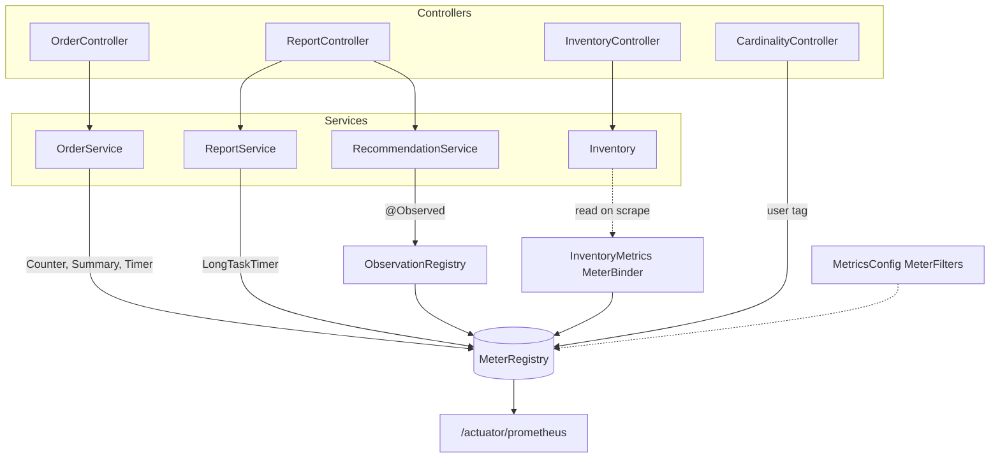
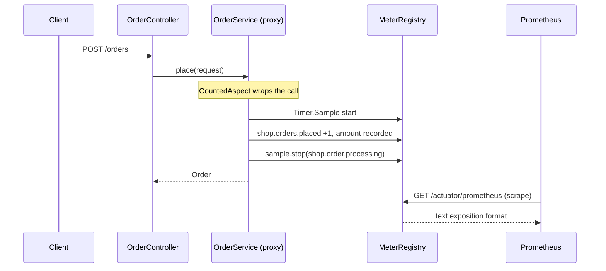
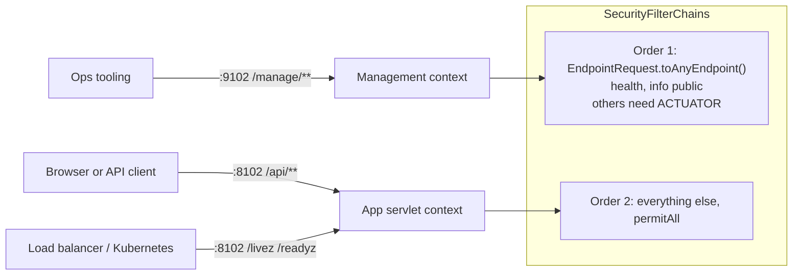
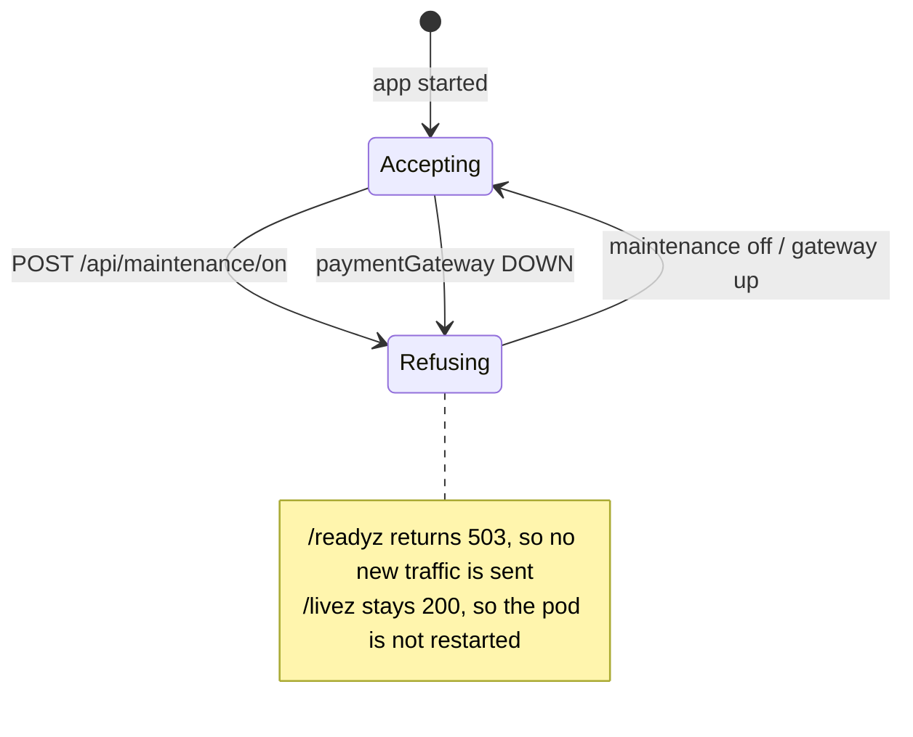
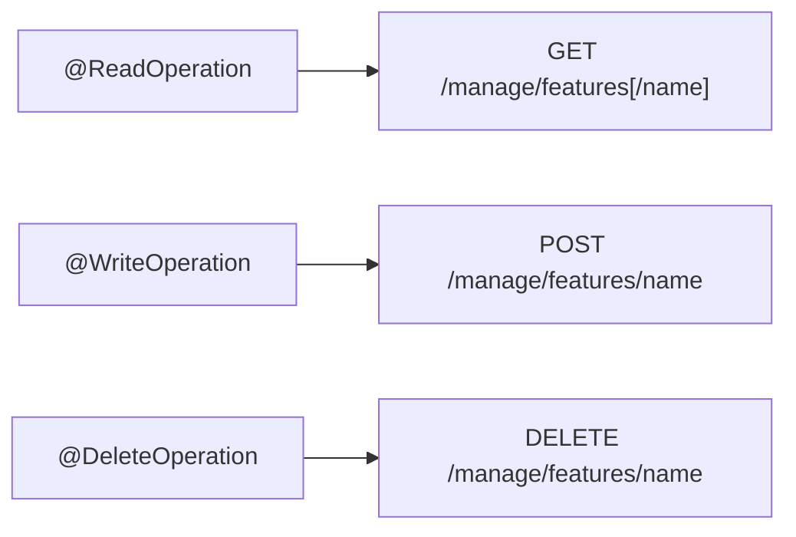

# learn11-actuator architecture

## actuator1-custom-metrics

How a request becomes a metric:

## actuator2-advanced-config

Two ports, two security chains:

Readiness vs liveness:

Custom endpoint operations map to HTTP methods:

