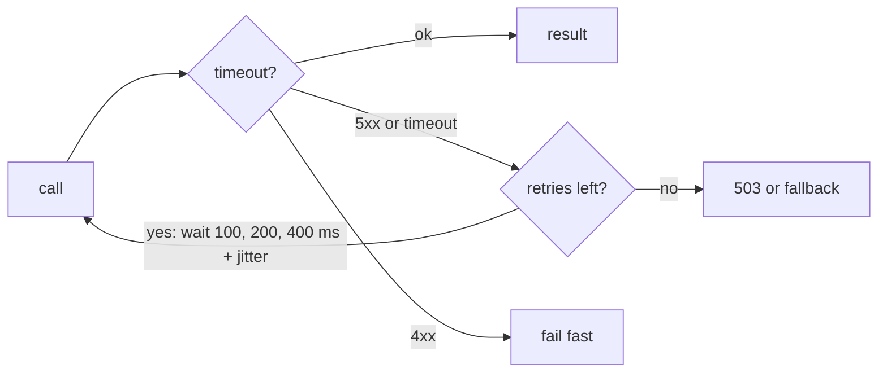
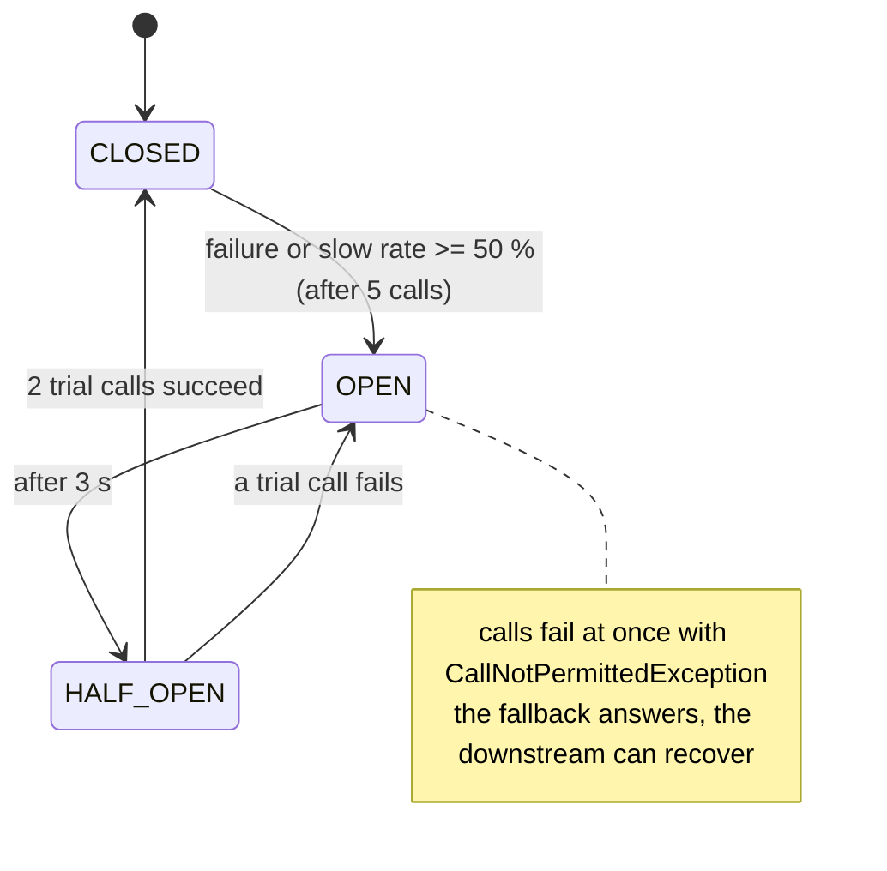

# learn12-resilience

How a service keeps working when its dependencies don't, and what
"consistent" means once data lives on more than one node.

| Module                     | Port | Learn                                                        |
| -------------------------- | ---- | ------------------------------------------------------------ |
| `flaky-service`            | 8131 | a downstream you can break at runtime (`POST /chaos`)        |
| `resilience1-spring-retry` | 8132 | timeouts, `@Retryable`, `RetryTemplate`, idempotency keys, `@ConcurrencyLimit` (Spring Framework 7, no library) |
| `resilience2-resilience4j` | 8133 | circuit breaker, retry, rate limiter, bulkhead, time limiter, fallbacks, metrics |
| `resilience3-cap-theorem`  | 8134 | 3 replicas, network partitions, CP vs AP, quorums, last-write-wins |

- How to run: [docs/HOW-TO-RUN.md](docs/HOW-TO-RUN.md)
- Architecture: [docs/architecture.md](docs/architecture.md)
- Decisions: [docs/DECISIONS.md](docs/DECISIONS.md)
- Requests: [http/](http/)

## The patterns in one table

| Pattern          | Problem it solves                        | Here                                         |
| ---------------- | ---------------------------------------- | -------------------------------------------- |
| Timeout          | a slow call holds a thread forever       | `setReadTimeout(1s)` on the `RestClient`     |
| Retry + backoff  | short glitches (a 503, a dropped connection) | `@Retryable(delay=100, multiplier=2)`    |
| Jitter           | all clients retry at the same moment     | `jitter = 50`                                |
| Retry only what heals | a 404 never gets better             | `includes = {5xx, timeouts}`                 |
| Idempotency key  | a retried POST charges twice             | `Idempotency-Key` header, made once per payment |
| Bulkhead         | one slow dependency uses all threads     | `@ConcurrencyLimit(2)`, BLOCK or REJECT      |
| Circuit breaker  | hammering a dependency that is down      | resilience2                                  |
| Rate limiter     | callers above the agreed rate            | resilience2                                  |
| Fallback         | something is better than an error        | resilience2                                  |

## resilience1-spring-retry

Spring Framework 7 has resilience built in:

| API                                   | What it does                                          |
| ------------------------------------- | ----------------------------------------------------- |
| `@EnableResilientMethods`             | turns on the annotations below                        |
| `@Retryable(includes, maxRetries, delay, multiplier, jitter, maxDelay)` | declarative retry with exponential backoff |
| `RetryTemplate` + `RetryPolicy.builder()` | the same, in code; `RetryListener` sees every retry |
| `@ConcurrencyLimit(n)`                | at most n calls at once; `BLOCK` queues, `REJECT` throws `InvocationRejectedException` |

The lost-reply case is the one people forget. The payment is charged, but
the reply never arrives (here, a 502). The client can't tell "not charged" from
"charged, reply lost", so it retries. The same `Idempotency-Key` makes the
server return the stored result instead of charging again.

A proxy pitfall to remember: `@Retryable` beans are CGLIB proxies. Reading a
field through the proxy gives `null`, so expose state through methods
(`PriceClient.attempts()`).

## resilience2-resilience4j

| Pattern          | Annotation + config                                             | Seen in the test                              |
| ---------------- | --------------------------------------------------------------- | --------------------------------------------- |
| Circuit breaker  | `@CircuitBreaker(name="prices")`; window 10, min 5 calls, 50 %, open 3 s | OPEN after 2 failing requests (6 attempts); downstream gets 0 calls while open |
| Half-open        | `permitted-number-of-calls-in-half-open-state: 2`, automatic transition | 2 good trial calls close it again    |
| Ignore 4xx       | `ignore-exceptions: HttpClientErrorException`                   | a 404 doesn't move the failure rate           |
| Slow calls       | `slow-call-duration-threshold: 800ms`                           | slow is treated like failed                   |
| Retry            | `@Retry(name="prices", fallbackMethod=...)`, 3 attempts, 100 ms × 2 | 2 glitches healed with no fallback        |
| Fallback         | `cachedPrice(...)`, overloaded per exception type               | last known price with `source: cache`         |
| Rate limiter     | `@RateLimiter(name="search")`, 5 per 1 s, no waiting            | 5 × 200 then 5 × 429 with `Retry-After`       |
| Bulkhead (semaphore) | `@Bulkhead(name="reports")`, 2 concurrent, no wait          | 2 ok, 3 `BulkheadFullException`               |
| Time limiter     | `@TimeLimiter(name="slow")` + thread-pool bulkhead, 500 ms      | fallback after about 0.5 s instead of 1.5 s   |
| Observability    | actuator `circuitbreakers`, `circuitbreakerevents`, health, Prometheus | state, transitions, retry and limiter metrics |

### Circuit breaker states

### Aspect order matters

Resilience4j nests the aspects like this:
`Retry( CircuitBreaker( RateLimiter( TimeLimiter( Bulkhead( call ) ) ) ) )`.

- Put the fallback on the outermost aspect you use (`@Retry` here). A fallback on
  `@CircuitBreaker` catches the error first, and Retry never retries. Our first
  run showed exactly that.
- Tell Retry to ignore `CallNotPermittedException`. Retrying an open breaker
  only adds delay.
- Every retry attempt counts as a call in the breaker's window, so 2 user
  requests × 3 attempts = 6 recorded failures.
