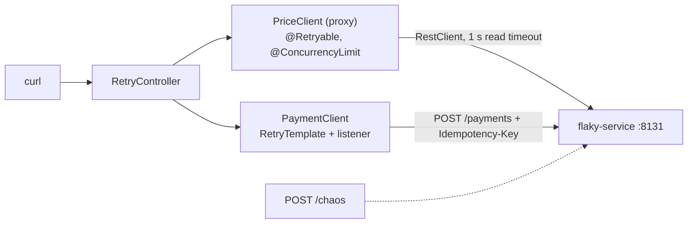
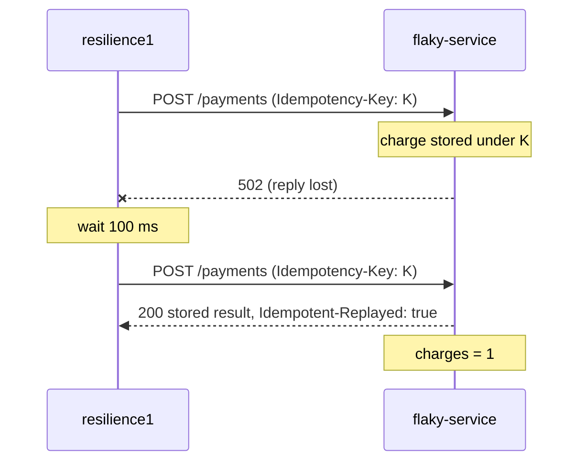
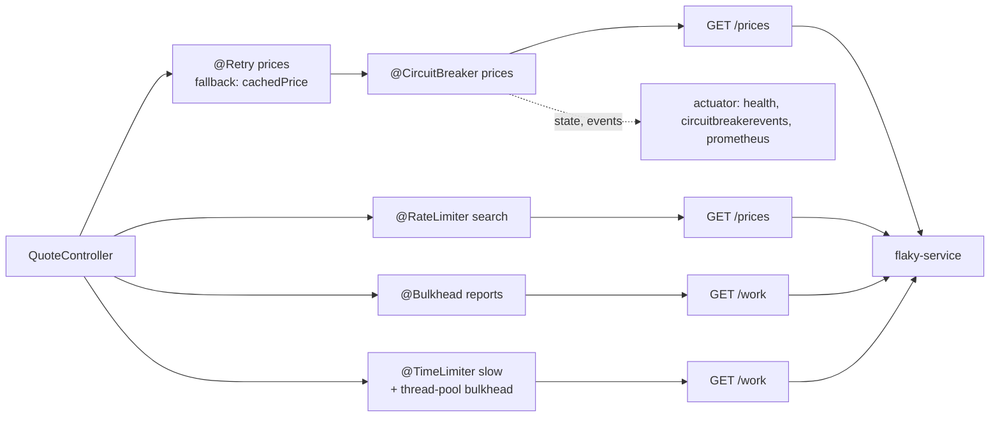
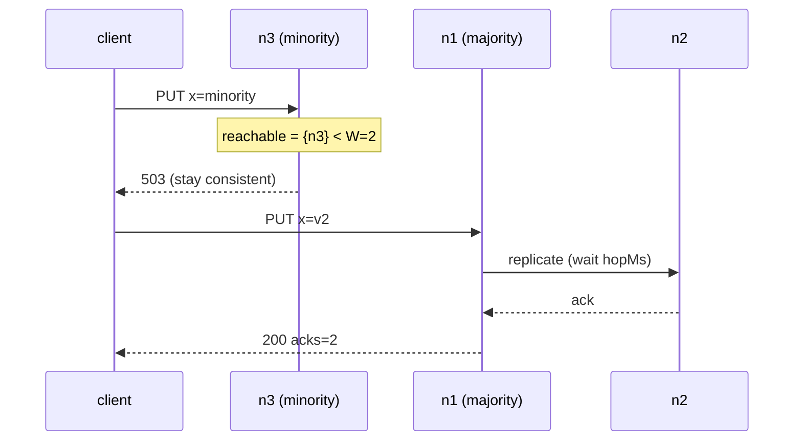
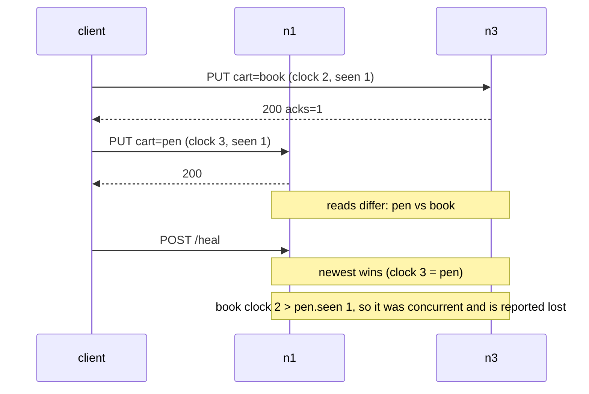
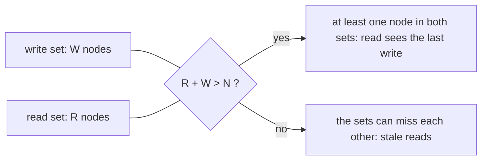

# learn12-resilience architecture

## resilience1-spring-retry

Lost reply, then a safe retry:

## resilience2-resilience4j

## resilience3-cap-theorem

CP write during a partition:

AP writes on both sides, then heal:

The quorum rule:

