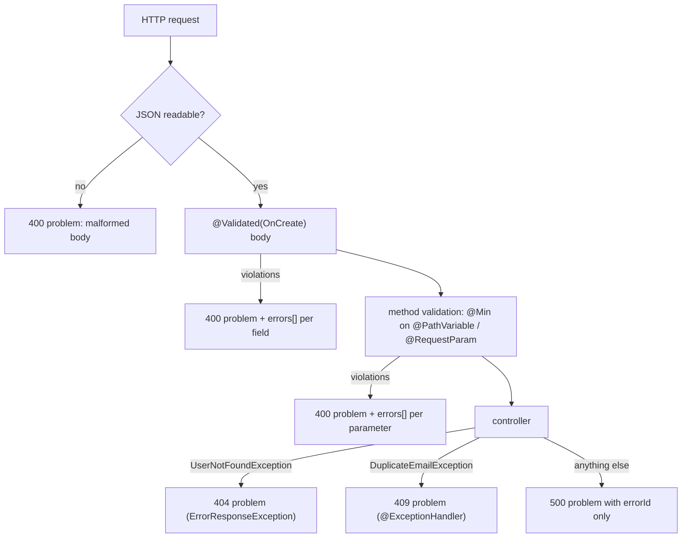

# learn13-rest-api

Everyday REST API skills for a Spring Boot developer.

| Module                             | Port | Learn                                                         |
| ---------------------------------- | ---- | ------------------------------------------------------------- |
| `rest1-validation-problem-details` | 8141 | Bean Validation (groups, custom and cross-field rules, method validation, i18n), RFC 9457 errors |
| `rest2-api-versioning`             | 8142 | Spring Framework 7 API versioning: header, query, baseline `1.1+`, deprecation headers |
| `rest3-http-interface-clients`     | 8143 | `@HttpExchange` clients, `@ImportHttpServices`, per-group config, error mapping, API version insert |
| `rest4-openapi`                    | 8144 | springdoc: OpenAPI 3 document, Swagger UI, schemas, security scheme, groups |

- How to run: [docs/HOW-TO-RUN.md](docs/HOW-TO-RUN.md)
- Architecture: [docs/architecture.md](docs/architecture.md)
- Decisions: [docs/DECISIONS.md](docs/DECISIONS.md)
- Requests: [http/](http/)

## rest1-validation-problem-details



| Concept                | Where                                                           |
| ---------------------- | --------------------------------------------------------------- |
| Standard constraints   | `@NotBlank`, `@Email`, `@Min`, `@Size`, `@Pattern`, nested `@Valid Address` |
| Groups                 | `OnCreate`: `id` must be null, password required. `OnUpdate`: `id` required. Selected with `@Validated(Group.class)` |
| Custom constraint      | `@StrongPassword` with its own `ConstraintValidator`             |
| Cross-field rule       | `@PasswordsMatch` on the class, reported on `confirmPassword`    |
| Method validation      | constraints on `@PathVariable` and `@RequestParam` are checked by Spring MVC itself |
| Messages and i18n      | `ValidationMessages.properties` and `_fr`; `Accept-Language: fr` |
| RFC 9457 body          | `type`, `title`, `status`, `detail`, `instance`, plus custom `errors`, `userId`, `email` |
| One place for errors   | `ApiExceptionHandler extends ResponseEntityExceptionHandler`     |
| Self-describing errors | `UserNotFoundException extends ErrorResponseException`           |
| No leaks               | unexpected errors return only an `errorId`; details go to the log |
| `instance`             | `ProblemInstanceAdvice` fills in the path (Spring leaves it empty) |

Example response:

```json
{
  "type": "https://example.test/problems/validation",
  "title": "Validation failed",
  "status": 400,
  "detail": "2 field(s) are invalid",
  "instance": "/users",
  "errors": [
    { "field": "address.pin", "message": "PIN must be 6 digits" },
    { "field": "confirmPassword", "message": "passwords do not match" }
  ]
}
```
