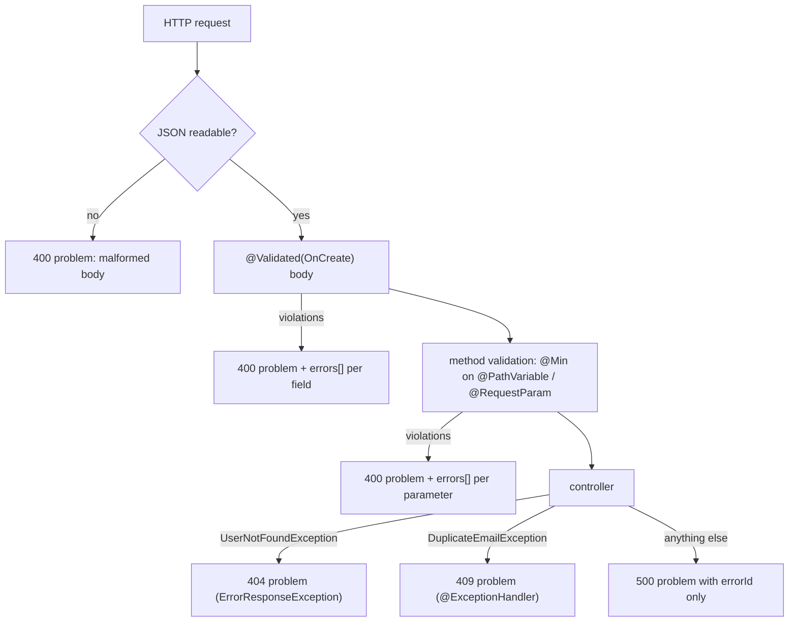
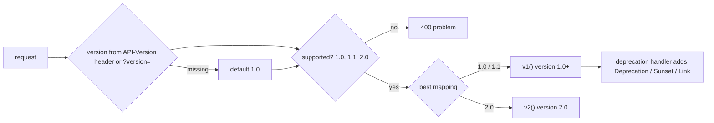
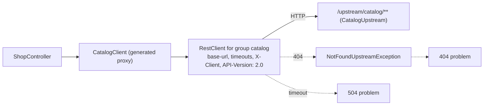

# learn13-rest-api

Everyday REST API skills for a Spring Boot developer.

| Module                             | Port | Learn                                                         |
| ---------------------------------- | ---- | ------------------------------------------------------------- |
| `rest1-validation-problem-details` | 8141 | Bean Validation (groups, custom and cross-field rules, method validation, i18n), RFC 9457 errors |
| `rest2-api-versioning`             | 8142 | Spring Framework 7 API versioning: header, query, baseline `1.1+`, deprecation headers |
| `rest3-http-interface-clients`     | 8143 | `@HttpExchange` clients, `@ImportHttpServices`, per-group config, error mapping, API version insert |
| `rest4-openapi`                    | 8144 | springdoc: OpenAPI 3 document, Swagger UI, schemas, security scheme, groups |

- How to run: [docs/HOW-TO-RUN.md](docs/HOW-TO-RUN.md)
- Architecture: [docs/architecture.md](docs/architecture.md)
- Decisions: [docs/DECISIONS.md](docs/DECISIONS.md)
- Requests: [http/](http/)

## rest1-validation-problem-details



| Concept                | Where                                                           |
| ---------------------- | --------------------------------------------------------------- |
| Standard constraints   | `@NotBlank`, `@Email`, `@Min`, `@Size`, `@Pattern`, nested `@Valid Address` |
| Groups                 | `OnCreate`: `id` must be null, password required. `OnUpdate`: `id` required. Selected with `@Validated(Group.class)` |
| Custom constraint      | `@StrongPassword` with its own `ConstraintValidator`             |
| Cross-field rule       | `@PasswordsMatch` on the class, reported on `confirmPassword`    |
| Method validation      | constraints on `@PathVariable` and `@RequestParam` are checked by Spring MVC itself |
| Messages and i18n      | `ValidationMessages.properties` and `_fr`; `Accept-Language: fr` |
| RFC 9457 body          | `type`, `title`, `status`, `detail`, `instance`, plus custom `errors`, `userId`, `email` |
| One place for errors   | `ApiExceptionHandler extends ResponseEntityExceptionHandler`     |
| Self-describing errors | `UserNotFoundException extends ErrorResponseException`           |
| No leaks               | unexpected errors return only an `errorId`; details go to the log |
| `instance`             | `ProblemInstanceAdvice` fills in the path (Spring leaves it empty) |

Example response:

```json
{
  "type": "https://example.test/problems/validation",
  "title": "Validation failed",
  "status": 400,
  "detail": "2 field(s) are invalid",
  "instance": "/users",
  "errors": [
    { "field": "address.pin", "message": "PIN must be 6 digits" },
    { "field": "confirmPassword", "message": "passwords do not match" }
  ]
}
```

## rest2-api-versioning

Spring Framework 7 has API versioning built in. A mapping can say
`version = "2.0"` (exactly this version) or `version = "1.1+"` (this version and
later, until a higher mapping takes over).

| Request (`API-Version`) | `GET /products/1`                         | `GET /products` | Headers                          |
| ----------------------- | ----------------------------------------- | --------------- | -------------------------------- |
| none → default `1.0`    | `{id, name, price}`                       | 404 (not yet)   | `Deprecation`, `Sunset`, `Link`  |
| `1.1`                   | same v1 shape (from the `1.0+` baseline)  | 200 (`1.1+`)    | `Deprecation`, `Sunset`          |
| `2.0`                   | `{id, title, price: {amount, currency}}`  | 200             | none                             |
| `3.0` or `abc`          | 400 problem, "Invalid API version"        | 400             |                                  |



| Setting                                  | Where              |
| ---------------------------------------- | ------------------ |
| header and query parameter names         | `spring.mvc.apiversion.use.*` |
| supported versions, default              | `spring.mvc.apiversion.supported`, `.default` |
| deprecation dates and links per version  | `VersioningConfig` with `StandardApiVersionDeprecationHandler` |
| make the version mandatory               | `spring.mvc.apiversion.required: true` (instead of a default) |
| version in the path (`/v2/products`)     | `spring.mvc.apiversion.use.path-segment: 0` |

Versioning rules of thumb:

- Bump the major version only for breaking changes (a renamed field, a type change, a removed endpoint).
- Adding a field is not breaking. Clients must ignore unknown fields.
- Announce removal with `Deprecation` and `Sunset` headers well before the date.

## rest3-http-interface-clients

Write a Java interface, and Spring generates the HTTP client.

```java
@HttpExchange("/upstream/catalog")
public interface CatalogClient {
    @GetExchange("/products/{id}") Product get(@PathVariable long id);
    @PostExchange("/products") ResponseEntity<Product> create(@RequestBody NewProduct p, @RequestHeader("Idempotency-Key") String key);
}
```

| Concept                  | Where                                                          |
| ------------------------ | -------------------------------------------------------------- |
| Register the client      | `@ImportHttpServices(group = "catalog", types = CatalogClient.class)` |
| Per-group config         | `spring.http.serviceclient.catalog.*`: `base-url`, timeouts, `default-header` |
| API version on requests  | `apiversion.default: 2.0` + `apiversion.insert.header: API-Version` |
| Error mapping            | `RestClientHttpServiceGroupConfigurer` adds a status handler (404 → `NotFoundUpstreamException`) |
| Status and headers       | return `ResponseEntity<T>` instead of `T`                      |
| Timeouts                 | `read-timeout: 1s` → `ResourceAccessException` → 504 problem   |
| Upstream                 | `CatalogUpstream` runs in the same app, so nothing leaves the machine |



Gotcha: the group's default API version key is `apiversion.default`, not
`apiversion.default-version`. The field is bound with `@Name("default")`, and
there's no config metadata to warn you, so the wrong key is silently ignored.
