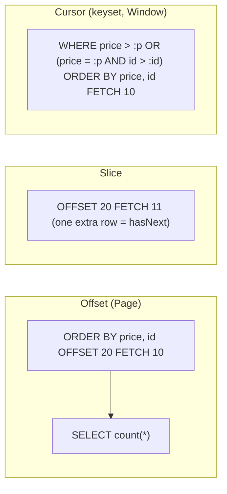

# learn14-data-jpa

Spring Data JPA topics that decide whether an app is fast and correct. Every
endpoint returns the SQL it caused (`sqlCount`, `sql`), so you can see the effect.

| Module                 | Port | Learn                                                          |
| ---------------------- | ---- | -------------------------------------------------------------- |
| `data1-jpa-essentials` | 8151 | N+1 and fixes, projections, offset vs slice vs cursor pagination, auditing, optimistic vs pessimistic vs atomic updates, transaction rules |

- How to run: [docs/HOW-TO-RUN.md](docs/HOW-TO-RUN.md)
- Architecture: [docs/architecture.md](docs/architecture.md)
- Decisions: [docs/DECISIONS.md](docs/DECISIONS.md)
- Requests: [http/data1-jpa.http](http/data1-jpa.http)

The data is 20 authors with 5 books each (100 rows) in in-memory H2.

## N+1 queries

| Endpoint                   | Code                                     | Statements |
| -------------------------- | ---------------------------------------- | ---------- |
| `/queries/n-plus-one`      | `findAll()` then `author.getBooks().size()` | 21 (1 + 20) |
| `/queries/fetch-join`      | `select distinct a from Author a left join fetch a.books` | 1 |
| `/queries/entity-graph`    | `@EntityGraph(attributePaths = "books")` | 1          |

`open-in-view: false` turns lazy loading in the controller into an error
instead of hidden queries, so services must fetch what they need.

## Projections

| Kind       | Code                                                    | SQL                          |
| ---------- | ------------------------------------------------------- | ---------------------------- |
| Interface  | `List<TitleAndPrice> findByPriceLessThan...`            | selects `title, price` only  |
| DTO record | `select new ...BookSummary(b.title, a.name) ...`        | one join, two columns        |
| Dynamic    | `<T> List<T> findByAuthorIdOrderById(Long, Class<T>)`   | the caller picks the shape   |

## Pagination: offset vs slice vs cursor



| | Offset `Page` | `Slice` | Cursor `Window` |
| --- | --- | --- | --- |
| Statements | 2 (rows + count) | 1 | 1 |
| Deep pages | slow: the database still walks the skipped rows | slow | fast: the index jumps straight to the key |
| Total / page numbers | yes | no | no |
| Rows inserted while paging | pages shift and repeat rows | same | stable, no repeats |
| Jump to page 7 | yes | yes | no (next / previous only) |
| Best for | admin tables with page numbers | "load more" with small offsets | feeds, infinite scroll, APIs, exports |

How the cursor works here:

1. Sort by `price, id`. `id` is the tie-breaker that makes the order unique.
   Without it, rows with the same price can be skipped or repeated.
2. The repository method is `Window<Book> findByOrderByPriceAscIdAsc(ScrollPosition, Limit)`.
3. The keys of the last row (`price`, `id`) are encoded as an opaque base64 cursor,
   for example `MTAwOjE4` (`100:18`).
4. The next request decodes it into `ScrollPosition.forward(Map.of("price", 100, "id", 18))`.
   Spring Data writes `where price > ? or price = ? and id > ?`.
5. Clients only pass back `nextCursor`. A broken cursor gets a 400.

Real SQL from the second page:

```sql
select ... from book b1_0
where b1_0.price > ? or b1_0.price = ? and b1_0.id > ?
order by b1_0.price, b1_0.id
fetch first ? rows only
```

Index to add in a real database: `create index on book (price, id)`.

## Concurrent updates: 20 requests take 1 unit each from stock 20

| Strategy    | Code                                              | Result                                   |
| ----------- | ------------------------------------------------- | ---------------------------------------- |
| Optimistic  | read, change, commit; `@Version` checked on UPDATE | losers get 409 and must retry; no lost updates |
| Pessimistic | `@Lock(PESSIMISTIC_WRITE)` = `SELECT ... FOR UPDATE` | all 20 succeed, one after another        |
| Atomic      | `update book set stock = stock - 1 where id = ? and stock > 0` | all 20 succeed, no read in Java  |

Rule of thumb: atomic SQL for counters, optimistic for user edits (show
"changed by someone else"), and pessimistic for short critical sections with
real contention.

## Transactions

| Case                                   | Result                                         |
| -------------------------------------- | ---------------------------------------------- |
| `RuntimeException` in `@Transactional` | rolled back                                    |
| audit with `REQUIRES_NEW` inside it    | kept: it committed in its own transaction      |
| checked exception, default rules       | committed anyway, a classic trap               |
| checked exception, `rollbackFor = X`   | rolled back                                    |
| `@Transactional` method called from the same class | no transaction: self-calls skip the proxy (so `AuditService` is a separate bean) |

## Auditing

`@EnableJpaAuditing` + `@CreatedDate` / `@LastModifiedDate` fill the
timestamps, and `@Version` counts the updates.
