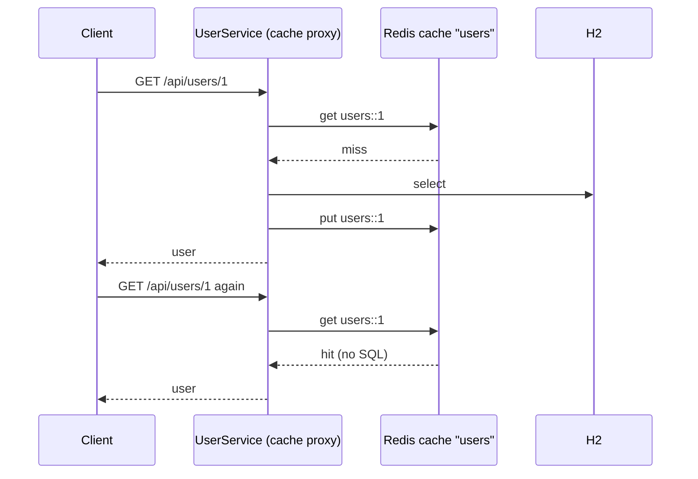

# learn2-cache-redis

The Spring Cache abstraction with Redis as the store, in front of a JPA (H2)
repository.

| Item      | Value                                                      |
| --------- | ---------------------------------------------------------- |
| Port      | 8080                                                       |
| Needs     | Redis on `localhost:6379` (`redis` / `redis`); H2 file DB is built in |
| Run       | `./gradlew :learn2-cache-redis:bootRun`                    |
| H2 console | <http://localhost:8080/h2-console> (`admin` / `admin`)   |

| Annotation                           | Method        | Effect                                       |
| ------------------------------------ | ------------- | -------------------------------------------- |
| `@EnableCaching`                     | application   | turns on the cache proxies                   |
| `@Cacheable(key = "#id")`            | get by id     | the first call hits the DB, then Redis       |
| `@Cacheable(key = "#root.methodName")` | list        | the whole list cached under one key          |
| `@CachePut(key = "#user.id")`        | update        | always runs, and refreshes the entry         |
| `@CacheEvict(key = "#id")`           | delete        | removes one entry                            |
| `@CacheEvict(allEntries = true)`     | create        | clears the cache so the list is not stale    |
| `@Caching(...)`                      | update        | combines several cache operations            |

Config: `spring.cache.type=redis`, `key-prefix=cache-redis`, `cache-null-values=false`.

Things to watch: cached entities must be serializable (`User implements
Serializable`), and self-calls inside `UserService` skip the proxy, so they
are not cached.
