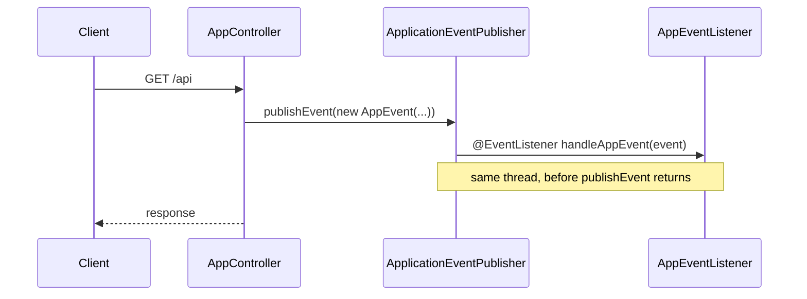

# learn3-events

Spring application events: decouple "something happened" from "who reacts".

| Item  | Value                                |
| ----- | ------------------------------------ |
| Port  | 8080                                 |
| Needs | nothing                              |
| Run   | `./gradlew :learn3-events:bootRun`, then `curl localhost:8080/api` |

| Piece              | Class                                 |
| ------------------ | ------------------------------------- |
| Event              | `AppEvent extends ApplicationEvent`   |
| Publisher          | `ApplicationEventPublisher` injected in `AppController` |
| Listener           | `AppEventListener` with `@EventListener` |

What to try next:

| Variation                               | Effect                                                    |
| --------------------------------------- | --------------------------------------------------------- |
| `@Async` on the listener + `@EnableAsync` | the publisher returns right away; the listener runs on another thread |
| `@TransactionalEventListener(phase = AFTER_COMMIT)` | runs only if the surrounding transaction commits (send emails after saving) |
| a plain record as the event (no `ApplicationEvent`) | works the same since Spring 4.2                |
