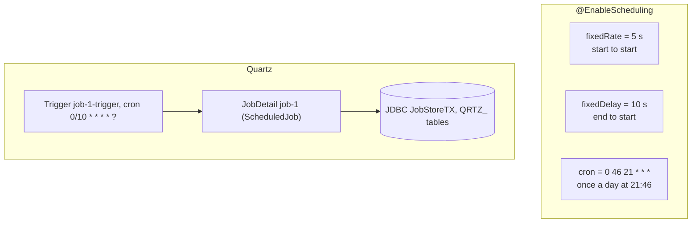

# learn4-schedulers

Two ways to run work on a timer: Spring's `@Scheduled`, and Quartz with a
JDBC job store.

| Item       | Value                                                    |
| ---------- | -------------------------------------------------------- |
| Port       | 8080                                                     |
| Needs      | nothing (H2 file DB holds the Quartz tables)             |
| Run        | `./gradlew :learn4-schedulers:bootRun` and watch the log |
| H2 console | <http://localhost:8080/h2-console> (`admin` / `admin`), tables `QRTZ_*` |

| Feature             | `@Scheduled`                           | Quartz                                      |
| ------------------- | -------------------------------------- | ------------------------------------------- |
| Setup               | one annotation                         | `JobDetail` + `Trigger` beans (`QuartzConfig`) |
| Survives restarts   | no                                     | yes: jobs and triggers are stored in the DB |
| Several instances   | runs on every instance                 | `isClustered=true` runs each job once in the cluster |
| Change at runtime   | no                                     | add, pause or reschedule through `Scheduler` |
| Threads             | `spring.task.scheduling.pool.size=3`   | Quartz `SimpleThreadPool`, 10 threads       |

For "run once across instances" with plain `@Scheduled`, add a distributed
lock such as ShedLock (Redis or JDBC).
