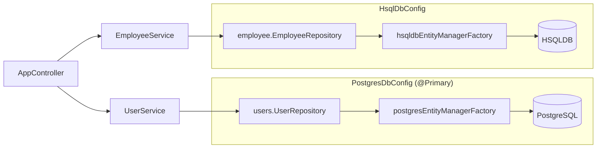

# learn5-multiple-dbs

Two databases in one app: each gets its own `DataSource`,
`EntityManagerFactory`, `TransactionManager` and repository package.

| Item  | Value                                                                |
| ----- | -------------------------------------------------------------------- |
| Port  | 8080                                                                 |
| Needs | PostgreSQL `localhost:5432/local` (`postgres` / `postgres`) and an HSQLDB server `localhost:9001/hsql` (`hsql` / `hsql`) |
| Run   | `./gradlew :learn5-multiple-dbs:bootRun`, then `curl localhost:8080/api` |

| Piece                         | Why                                                         |
| ----------------------------- | ----------------------------------------------------------- |
| `@EnableJpaRepositories(basePackages, entityManagerFactoryRef, transactionManagerRef)` | ties each repository package to its database |
| `@Primary` on the Postgres beans | the default when a bean isn't qualified                   |
| `@ConfigurationProperties("spring.datasource.postgres")` | separate property trees per database |
| `EntityManagerFactoryBuilder`  | builds each factory with its own JPA properties            |

Quick local setup without servers: point the HSQLDB side at memory with
`--spring.datasource.hsqldb.jdbc-url=jdbc:hsqldb:mem:hsql` and
`--spring.datasource.hsqldb.jpa.properties.hibernate.hbm2ddl.auto=update`.

A transaction covers one database only. Writing to both atomically needs
XA (JTA) or, better, a design that doesn't need it (outbox, saga).
