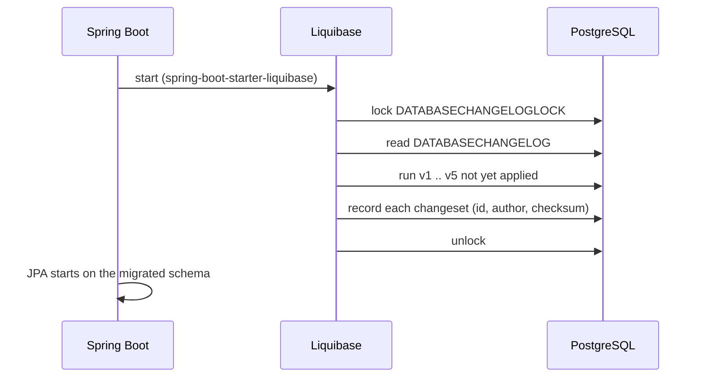

# learn6-db-migrations

Version-controlled schema changes, applied at startup.

| Module                                   | What                                          |
| ---------------------------------------- | --------------------------------------------- |
| `learn1-liquibase-basic`                 | Liquibase with JSON changelogs on PostgreSQL  |
| `learn2-liquibase-existing-db-migrations` | link to a separate migration utility project |

| Item  | Value                                                         |
| ----- | ------------------------------------------------------------- |
| Port  | 8080                                                          |
| Needs | PostgreSQL `localhost:5432/local` (`postgres` / `postgres`)   |
| Run   | `./gradlew :learn6-db-migrations:learn1-liquibase-basic:bootRun` |

Changelog: `db/migrations/changelog-master.json` includes `v1__create_users_table`,
`v2__add_age_column`, `v3__add_name_column`,
`v4__add_unique_constraint_to_users` and `v5__drop_unique_constraint`.

Rules:

- Never edit an applied changeset, because its checksum is stored. Add a new one.
- Keep `ddl-auto` off (`none` / `validate`) when migrations own the schema.
- Flyway is the SQL-first alternative; `learn8-security/jwt/jwt7` and `jwt8` use it.
- Boot 4 needs `spring-boot-starter-liquibase`. The bare `liquibase-core` jar
  no longer turns the migration on.
