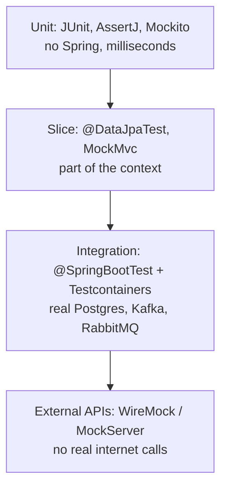
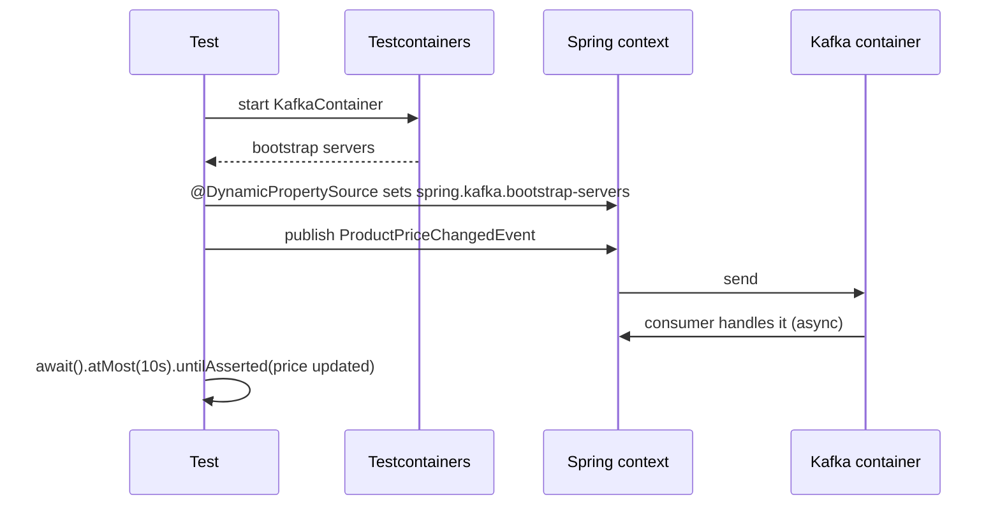

# learn7-testing

From plain unit tests to integration tests with real brokers in containers.

| Module                                  | Learn                                                          |
| --------------------------------------- | -------------------------------------------------------------- |
| `testing1-unit-junit`                   | JUnit 5 basics                                                 |
| `testing2-unit-assertj`                 | fluent assertions with AssertJ                                 |
| `testing3-junit5-advance-features-samples` | conditional execution, lifecycle callbacks, `@ParameterizedTest`, `@Nested`, test instance lifecycle, parallel classes |
| `testing4-unit-mockito`                 | `@Mock`, `@InjectMocks`, `ArgumentCaptor`, `verify`            |
| `testing5-test-containers`              | PostgreSQL container for `@SpringBootTest` + REST Assured and for `@DataJpaTest` |
| `testing6-kafka-awaitility`             | Kafka container; Awaitility for asynchronous consumers         |
| `testing7-rabbitmq-awaitility`          | RabbitMQ container; Awaitility                                 |
| `testing8-integration-wiremock`         | stub a remote HTTP API with WireMock (code and classpath stubs) |
| `testing9-integration-mockserver`       | the same with MockServer, in-process and as a container        |

Run all tests: `./gradlew :learn7-testing:test`. Modules 5–7 and the
MockServer container test need Docker.

| Tool            | When                                                         |
| --------------- | ------------------------------------------------------------ |
| Mockito         | the collaborator is ours and slow or not built yet           |
| Testcontainers  | the dependency is infrastructure (DB, broker) and behaviour matters |
| WireMock / MockServer | a third-party HTTP API: control replies and failures   |
| Awaitility      | the result appears later (messaging, `@Async`)               |

Boot 4 notes: test slices moved to their own starters (`spring-boot-starter-data-jpa-test`,
`spring-boot-starter-webmvc-test`), and Testcontainers 2 renamed its modules.
See [../docs/UPGRADE-BOOT-4.md](../docs/UPGRADE-BOOT-4.md).
