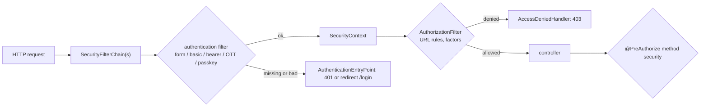
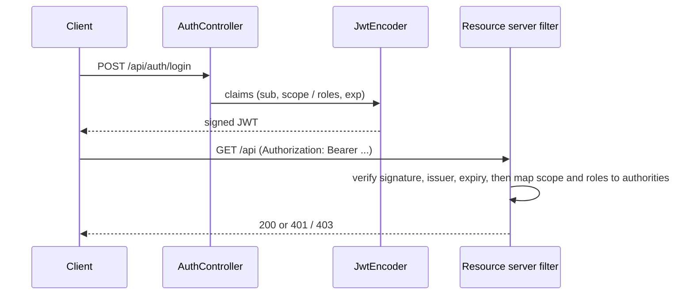
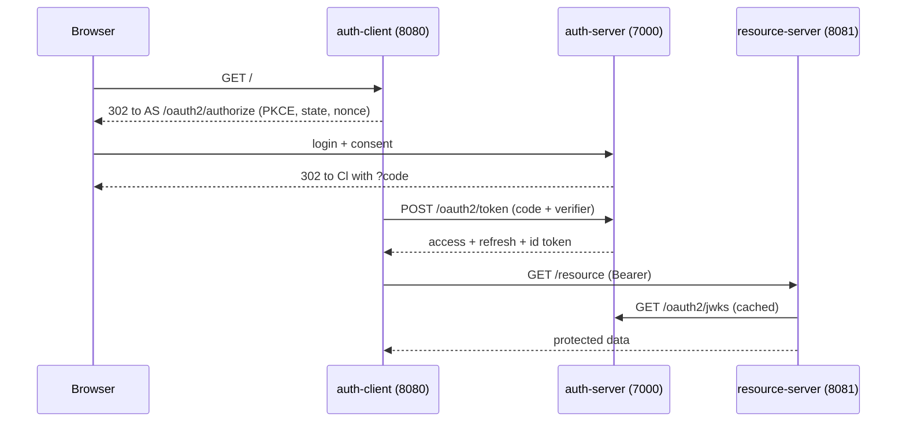

# learn8-security

Spring Security 7 from the default login page to OAuth2 servers and MFA.

| Group            | Modules        | Learn                                                  |
| ---------------- | -------------- | ------------------------------------------------------ |
| `basic`          | basic1–basic6  | default security, form and HTTP Basic login, sessions, custom pages, `UserDetailsService` |
| `jwt`            | jwt1–jwt8      | issuing and checking JWTs, scopes, roles, method security, custom errors, real apps |
| `oauth2/security1-oauth2-basic` | learn1–learn4 | `WebClient`, OAuth2 login with GitHub, authorized clients |
| `oauth2/security2-oauth2-auth-server` | auth1–auth5 | Spring Authorization Server, resource server, keys, refresh tokens |
| `mfa`            | mfa1–mfa5      | TOTP, email links, passkeys, step-up, Keycloak OTP. See [mfa/README.md](mfa/README.md) |

Reference: the official
[Spring Security samples](https://github.com/spring-projects/spring-security-samples).

## How a request is secured

## basic

All run on 8080. `GET /` and `GET /secure` are the protected pages.

| Module                            | Shows                                                        |
| --------------------------------- | ------------------------------------------------------------ |
| `basic1-autoconfiguration`        | Boot's defaults: a generated password and the login form     |
| `basic2-explicit`                 | an explicit `SecurityFilterChain`, form + Basic, in-memory user |
| `basic3-max-sessions`             | `maximumSessions(1)` + `maxSessionsPreventsLogin`: a second login is refused |
| `basic4-custom-auth-pages`        | own login and logout pages (Thymeleaf)                       |
| `basic5-http-basic-only`          | HTTP Basic only, stateless (no session cookie)               |
| `basic6-custom-user-details-service` | users from our own repository, login by email, BCrypt     |

## jwt

| Module                          | Shows                                                          |
| ------------------------------- | -------------------------------------------------------------- |
| `jwt1-basic`                    | HS256 shared secret, 5-second tokens (watch expiry + clock skew) |
| `jwt2-basic-keys`               | RS256 with a private and public key pair                       |
| `jwt3-scopes`                   | `SCOPE_message:read/write/update` URL rules                    |
| `jwt4-roles`                    | roles in the token, `hasRole`, `hasAnyRole`                    |
| `jwt5-method-level-security`    | `@PreAuthorize` with scopes, roles and a role hierarchy        |
| `jwt6-customization`            | JSON 401/403 bodies (`AuthenticationEntryPoint`, `AccessDeniedHandler`), `CustomJwtAuthenticationConverter` |
| `jwt7-employee-management-basic` | a real app: H2 + Flyway users, BCrypt, CEO / HR / MANAGER / EMPLOYEE rules |
| `jwt8-employee-management`      | the same as hexagonal ports and adapters, permission checks via `@access` beans |

## oauth2

| Module | Shows |
| ------ | ----- |
| `security1/learn1-webclient`            | calling GitHub with a plain `WebClient`        |
| `security1/learn2-webclient-multiple`   | several `WebClient` beans                      |
| `security1/learn3-authorized-webclient` | OAuth2 login with GitHub; the `WebClient` sends the user's token |
| `security1/learn4-authorized-webclient-multiple` | two GitHub registrations side by side |
| `security2/auth1-auth-server-auto-config` | Authorization Server from properties; `login-client` (code), `messaging-client` (client credentials) |
| `security2/auth2-auth-server-manual`    | the same with explicit beans                   |
| `security2/auth3-resource-server`       | + a resource server (8081) validating the server's JWTs |
| `security2/auth4-auth-server-keys`      | fixed signing keys instead of keys generated per start |
| `security2/auth5-refresh-token`         | 60 s access tokens, refresh tokens, `offline_access` |

Security 7 requires PKCE for the code flow by default. The Spring OAuth2 client
sends it automatically, and manual curl flows must add it (see
[../docs/HOW-TO-RUN.md](../docs/HOW-TO-RUN.md)). The GitHub modules call the
real GitHub API and need your own OAuth app (`GITHUB_CLIENT_ID`, `GITHUB_CLIENT_SECRET`).
