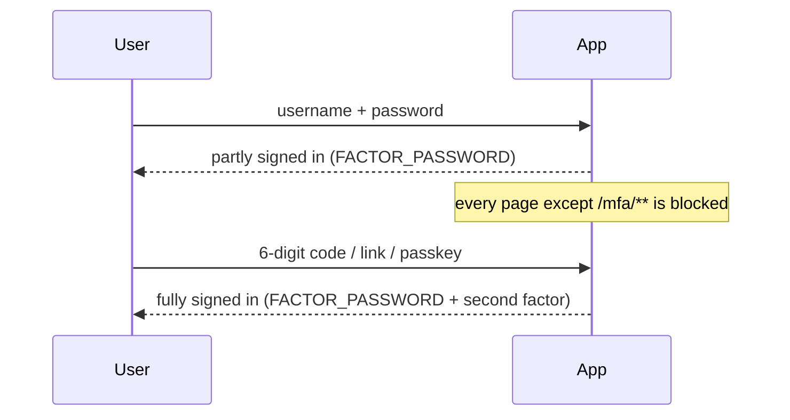
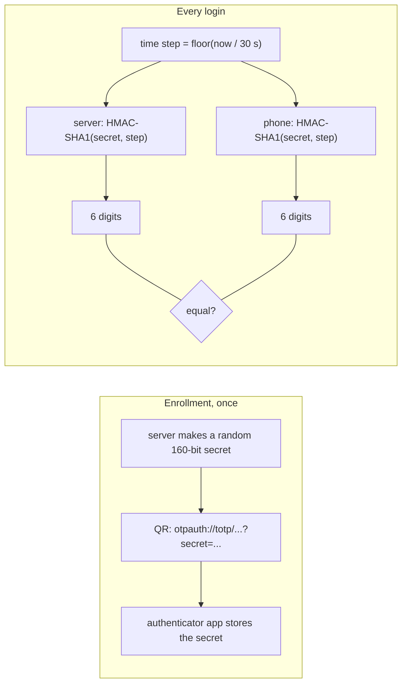

# learn8-security/mfa

Multi-factor authentication with Spring Security 7. Everything runs locally,
and no request leaves the machine (no SMS gateway, no hosted QR service).

| Module              | Port | Second factor                         | Learn                                                    |
| ------------------- | ---- | ------------------------------------- | -------------------------------------------------------- |
| `mfa1-totp`         | 8121 | authenticator app (TOTP, RFC 6238)    | custom factor, enrollment, recovery codes, replay, lockout, trusted device |
| `mfa2-email-ott`    | 8122 | one-time link by email (MailHog)      | `@EnableMultiFactorAuthentication`, built-in OTT login   |
| `mfa3-passkeys`     | 8123 | passkey (WebAuthn)                    | phishing-resistant factor, passwordless login            |
| `mfa4-step-up`      | 8124 | fresh password for risky actions      | `RequiredFactor.validDuration`, step-up authentication   |
| `mfa5-keycloak-otp` | 8125 | Keycloak OTP (identity provider)      | delegate MFA to an IdP with OAuth2 login                 |

- How to run: [docs/HOW-TO-RUN.md](docs/HOW-TO-RUN.md)
- Architecture: [docs/architecture.md](docs/architecture.md)
- Decisions: [docs/DECISIONS.md](docs/DECISIONS.md)
- Requests: [http/](http/)

## How MFA works

A factor is one kind of proof:

| Kind                | Examples                         |
| ------------------- | -------------------------------- |
| something you know  | password, PIN                    |
| something you have  | phone with an authenticator app, security key, email inbox |
| something you are   | fingerprint or face, usually checked on the device by a passkey |

MFA means two different kinds. Two passwords are still one factor.

In Spring Security 7, every way of signing in adds a factor authority
(`FACTOR_PASSWORD`, `FACTOR_OTT`, `FACTOR_WEBAUTHN`, ...). Authorization rules
ask for the set of factors they need. A missing factor sends the user to the
page for that factor, not to a 403.

## TOTP in one picture

The phone never talks to the server or to Google. Both sides only share the
secret and the clock, so TOTP needs no third-party service.

## mfa1-totp

| Concern            | How it's handled                                                       |
| ------------------ | ---------------------------------------------------------------------- |
| Custom factor      | `TotpAuthenticationFilter` + `TotpAuthenticationProvider` add `FACTOR_TOTP` |
| Rules              | `AuthorizationManagerFactories.multiFactor().requireFactors(PASSWORD, TOTP)` |
| Missing factor     | `defaultDeniedHandlerForMissingAuthority(... "/mfa/totp", "FACTOR_TOTP")` |
| Enrollment         | secret kept in the session until the first valid code; QR drawn locally with ZXing |
| Secret at rest     | AES-256-GCM (`Encryptors.delux`) with a per-user salt and a key from config |
| Clock drift        | accept the previous, current and next 30 s step                         |
| Replay             | remember the last used step; the same code can't be used twice          |
| Brute force        | 5 wrong codes lock the user for 5 minutes                               |
| Lost phone         | 8 recovery codes, BCrypt-hashed, single use, shown once                 |
| Session fixation   | new session id after the second factor                                  |
| Trusted device     | HMAC-signed, HttpOnly cookie for 30 days, bound to the user name        |

Users: `alice / password` and `bob / password`.

## mfa2-email-ott

The built-in Security 7 path: no custom filter at all.

| Concern            | How it's handled                                                          |
| ------------------ | ------------------------------------------------------------------------- |
| Rule               | `@EnableMultiFactorAuthentication(authorities = {PASSWORD, OTT})` on every authenticated request |
| Second factor      | `oneTimeTokenLogin()`: `POST /ott/generate` makes a token, `/login/ott` consumes it |
| Delivery           | `EmailLinkSender` (`OneTimeTokenGenerationSuccessHandler`) mails the link to MailHog |
| Missing factor     | Spring redirects to `/login?factor.type=ott&factor.reason=missing` with the username pre-filled |
| Who gets the link  | a custom `GenerateOneTimeTokenRequestResolver` uses the signed-in user and ignores the form |
| Lifetime           | `mfa.ott-ttl` (5 minutes), single use (`InMemoryOneTimeTokenService`)     |
| Order of factors   | either order works; the session holds both factors once both are done    |
| User enumeration   | always redirects to `/ott/sent`, whether or not the user exists           |

Email is a weaker factor than TOTP or passkeys. Anyone who controls the
inbox (or a forwarding rule) gets the link. It's a common fallback, though, and it
shows the framework's built-in flow.

## mfa3-passkeys

A passkey is a key pair. The private key stays on the device (phone, laptop
TPM, security key), and the server stores only the public key.

| Concern            | How it's handled                                                         |
| ------------------ | ------------------------------------------------------------------------ |
| Enable             | `http.webAuthn(...)` with `rpId`, `rpName`, `allowedOrigins`; `spring-security-webauthn` |
| Rule               | `@EnableMultiFactorAuthentication(PASSWORD, WEBAUTHN, when = WEBAUTHN_REGISTERED)` |
| Opt-in MFA         | users without a passkey sign in with the password only; MFA starts the moment one is registered |
| Register           | `/webauthn/register` (default page): options → `navigator.credentials.create` → `POST /webauthn/register` |
| Sign in            | "Sign in with a passkey" on `/login`; either factor can come first        |
| Storage            | `PublicKeyCredentialUserEntityRepository` + `UserCredentialRepository` (in-memory maps) |
| Cloned keys        | the signature counter is stored and must keep going up                    |
| Phishing           | the browser signs only for `rpId=localhost` from the allowed origin, so a fake site gets nothing |

Why passkeys beat codes: there's nothing to type, so nothing can be phished or
replayed. A TOTP code typed into a fake site works on the real one for 30
seconds. A passkey signature made for another origin is never accepted.

## mfa4-step-up

Step-up authentication: a long session for reading, and a fresh proof for risky actions.

| Concern            | How it's handled                                                            |
| ------------------ | --------------------------------------------------------------------------- |
| Rule               | `AllRequiredFactorsAuthorizationManager` with `passwordAuthority().validDuration(2m)` on `/transfer/**` |
| Timestamp          | every `FactorGrantedAuthority` carries `issuedAt`, shown on the statement page |
| Expired factor     | Spring redirects to `/login?factor.type=password&factor.reason=expired`      |
| After re-auth      | the saved request (`/transfer`) opens again with a new `issuedAt`            |
| Other pages        | `/` keeps working for the whole 30-minute session                            |

The same rule works with any factor: `ottAuthority()`, `webauthnAuthority()`
or a custom one like `FACTOR_TOTP`. "Ask for the passkey again before deleting
the account" is one line.

## mfa5-keycloak-otp

Here the app delegates MFA to an identity provider. It never sees a password
or an OTP. Keycloak runs both factors and returns an ID token.

| Concern            | How it's handled                                                         |
| ------------------ | ------------------------------------------------------------------------ |
| Login              | `oauth2Login()` with `issuer-uri`; endpoints come from `.well-known/openid-configuration` |
| Code flow security | Spring sends PKCE (`S256`) and a `nonce`; the client secret stays on the server |
| MFA setup          | realm import gives alice the `CONFIGURE_TOTP` required action, so the first login shows a QR code |
| OTP policy         | `otpPolicy*` in the realm: SHA1, 6 digits, 30 s, look-ahead 1, codes not reusable |
| Brute force        | `bruteForceProtected: true`, `failureFactor: 5`                          |
| Strength claim     | `acr` in the ID token; the app could require a level                     |
| Logout             | `OidcClientInitiatedLogoutSuccessHandler` ends the Keycloak session too  |

### Build it yourself (mfa1–mfa4) vs use an identity provider (mfa5)

| Topic                  | In the app                            | Identity provider                           |
| ---------------------- | ------------------------------------- | ------------------------------------------- |
| Code you own           | factors, storage, lockout, recovery   | an OAuth2 client config                     |
| Many apps, one login   | each app repeats MFA                  | single sign-on, MFA once                    |
| New factor types       | write them                            | toggle in the admin console (OTP, passkeys, ...) |
| Policy changes         | redeploy                              | change in the realm                         |
| Extra moving part      | none                                  | the IdP must be up, upgraded and backed up  |
| Custom UX              | full control                          | themes only                                 |

Rule of thumb: one app with simple needs can build it. Several apps, or
audit and compliance needs, usually justify an identity provider.
