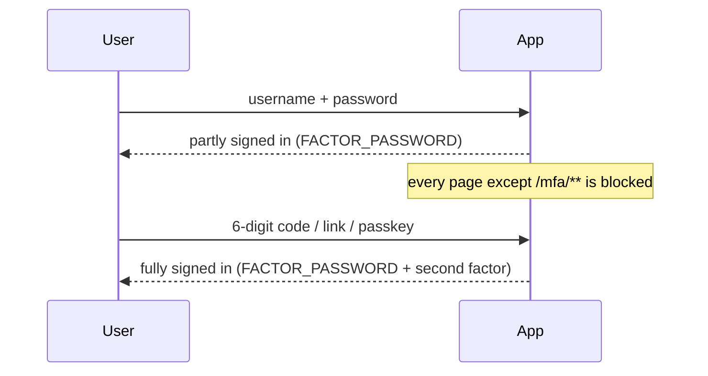
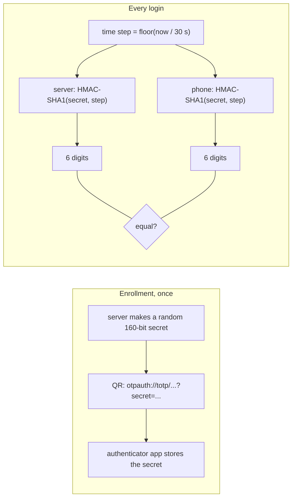

# learn8-security/mfa

Multi-factor authentication with Spring Security 7. Everything runs locally,
and no request leaves the machine (no SMS gateway, no hosted QR service).

| Module              | Port | Second factor                         | Learn                                                    |
| ------------------- | ---- | ------------------------------------- | -------------------------------------------------------- |
| `mfa1-totp`         | 8121 | authenticator app (TOTP, RFC 6238)    | custom factor, enrollment, recovery codes, replay, lockout, trusted device |
| `mfa2-email-ott`    | 8122 | one-time link by email (MailHog)      | `@EnableMultiFactorAuthentication`, built-in OTT login   |
| `mfa3-passkeys`     | 8123 | passkey (WebAuthn)                    | phishing-resistant factor, passwordless login            |
| `mfa4-step-up`      | 8124 | fresh password for risky actions      | `RequiredFactor.validDuration`, step-up authentication   |
| `mfa5-keycloak-otp` | 8125 | Keycloak OTP (identity provider)      | delegate MFA to an IdP with OAuth2 login                 |

- How to run: [docs/HOW-TO-RUN.md](docs/HOW-TO-RUN.md)
- Architecture: [docs/architecture.md](docs/architecture.md)
- Decisions: [docs/DECISIONS.md](docs/DECISIONS.md)
- Requests: [http/](http/)

## How MFA works

A factor is one kind of proof:

| Kind                | Examples                         |
| ------------------- | -------------------------------- |
| something you know  | password, PIN                    |
| something you have  | phone with an authenticator app, security key, email inbox |
| something you are   | fingerprint or face, usually checked on the device by a passkey |

MFA means two different kinds. Two passwords are still one factor.

In Spring Security 7, every way of signing in adds a factor authority
(`FACTOR_PASSWORD`, `FACTOR_OTT`, `FACTOR_WEBAUTHN`, ...). Authorization rules
ask for the set of factors they need. A missing factor sends the user to the
page for that factor, not to a 403.

## TOTP in one picture

The phone never talks to the server or to Google. Both sides only share the
secret and the clock, so TOTP needs no third-party service.

## mfa1-totp

| Concern            | How it's handled                                                       |
| ------------------ | ---------------------------------------------------------------------- |
| Custom factor      | `TotpAuthenticationFilter` + `TotpAuthenticationProvider` add `FACTOR_TOTP` |
| Rules              | `AuthorizationManagerFactories.multiFactor().requireFactors(PASSWORD, TOTP)` |
| Missing factor     | `defaultDeniedHandlerForMissingAuthority(... "/mfa/totp", "FACTOR_TOTP")` |
| Enrollment         | secret kept in the session until the first valid code; QR drawn locally with ZXing |
| Secret at rest     | AES-256-GCM (`Encryptors.delux`) with a per-user salt and a key from config |
| Clock drift        | accept the previous, current and next 30 s step                         |
| Replay             | remember the last used step; the same code can't be used twice          |
| Brute force        | 5 wrong codes lock the user for 5 minutes                               |
| Lost phone         | 8 recovery codes, BCrypt-hashed, single use, shown once                 |
| Session fixation   | new session id after the second factor                                  |
| Trusted device     | HMAC-signed, HttpOnly cookie for 30 days, bound to the user name        |

Users: `alice / password` and `bob / password`.
