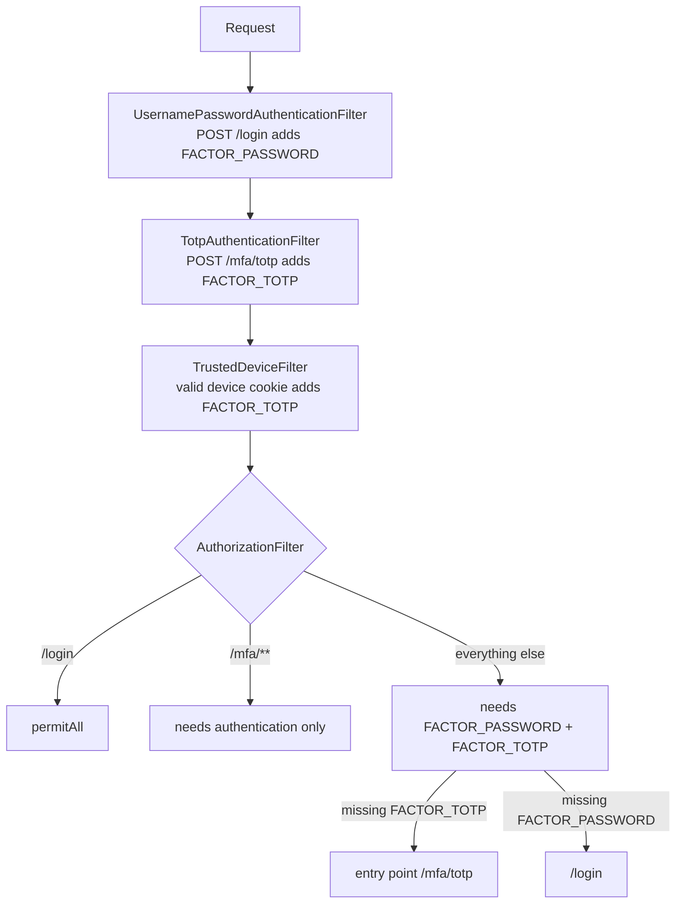
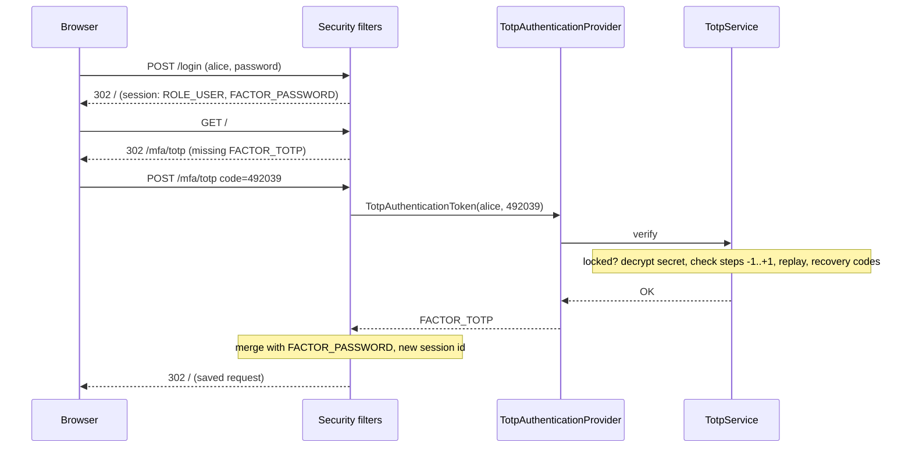
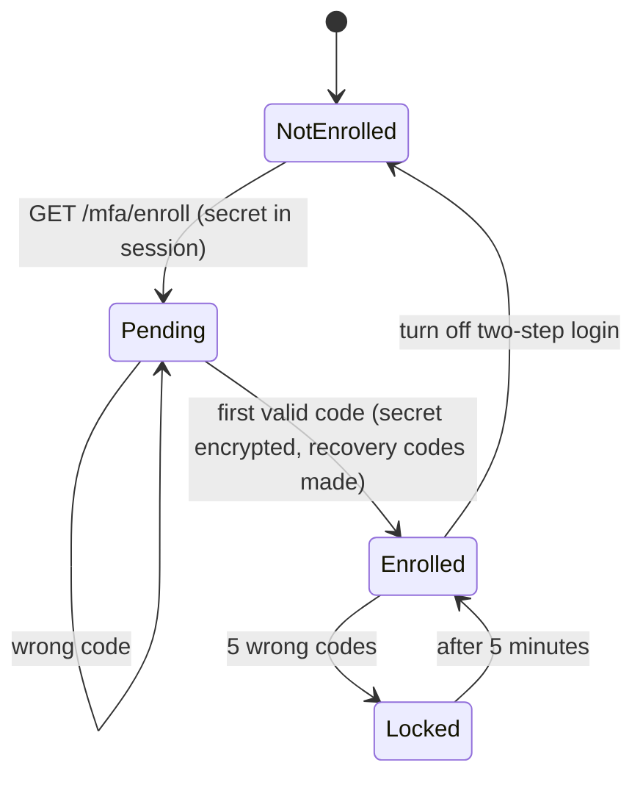
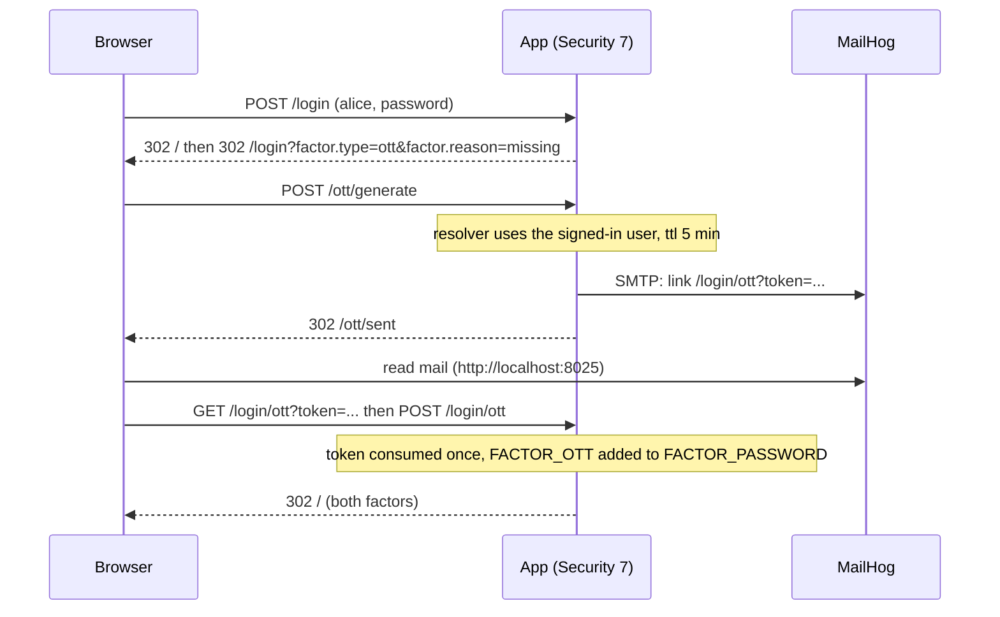
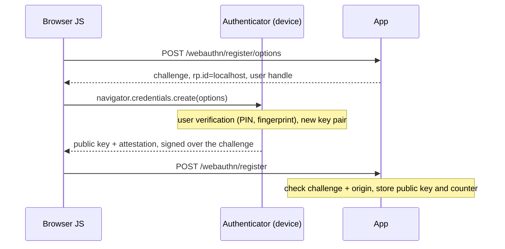
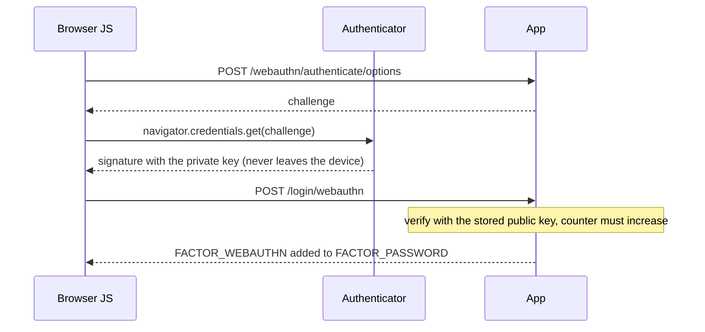
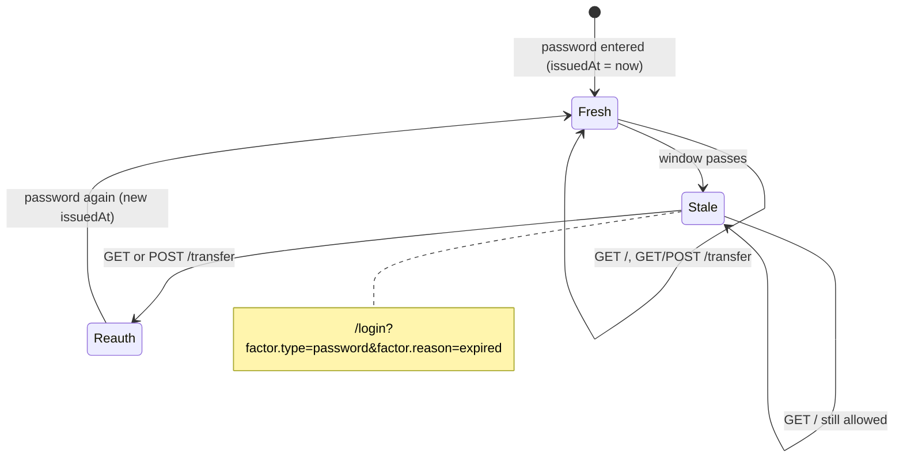
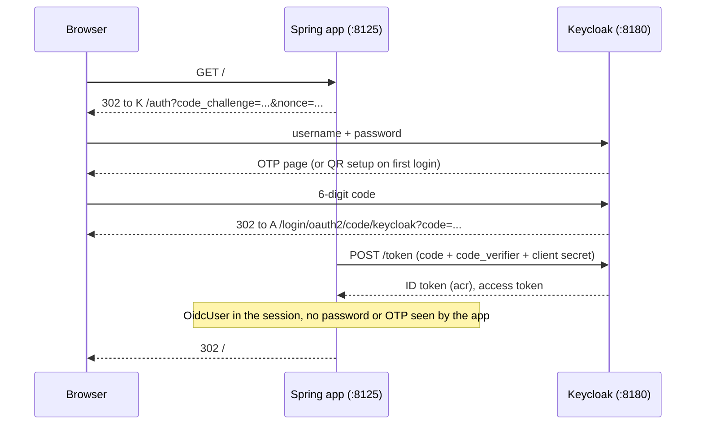

# MFA architecture

## mfa1-totp filter chain

## Login with TOTP

## Enrollment states

## mfa2-email-ott

## mfa3-passkeys

Registration:

Sign-in as the second factor:

## mfa4-step-up

## mfa5-keycloak-otp

