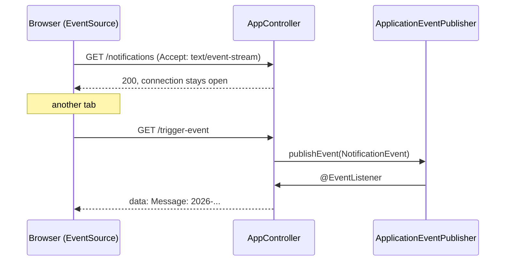

# learn9-sse

Server-Sent Events: a long-lived HTTP response that the server keeps writing
to. The browser reconnects automatically with `EventSource`.

| Item  | Value                                                    |
| ----- | -------------------------------------------------------- |
| Port  | 8080                                                     |
| Needs | nothing                                                  |
| Run   | `./gradlew :learn9-sse:bootRun`, open <http://localhost:8080> |

| Endpoint             | Built with                              | Sends                              |
| -------------------- | --------------------------------------- | ---------------------------------- |
| `GET /events`        | `Flux.interval(1s)` (WebFlux types)     | a tick every second                |
| `GET /events/emitter` | `SseEmitter` (Spring MVC)              | events pushed by a `ScheduledExecutorService` |
| `GET /notifications` | `SseEmitter` fed by `@EventListener`    | a message whenever an event is published |
| `GET /trigger-event` | `ApplicationEventPublisher`             | publishes a `NotificationEvent`    |

Try it with curl: `curl -N localhost:8080/events`.

| SSE vs WebSocket | SSE                         | WebSocket                     |
| ---------------- | --------------------------- | ----------------------------- |
| Direction        | server to client            | both ways                     |
| Protocol         | plain HTTP                  | upgrade to `ws://`            |
| Reconnect        | built in (`Last-Event-ID`)  | write it yourself             |
| Good for         | notifications, live feeds   | chat, games, collaboration    |
